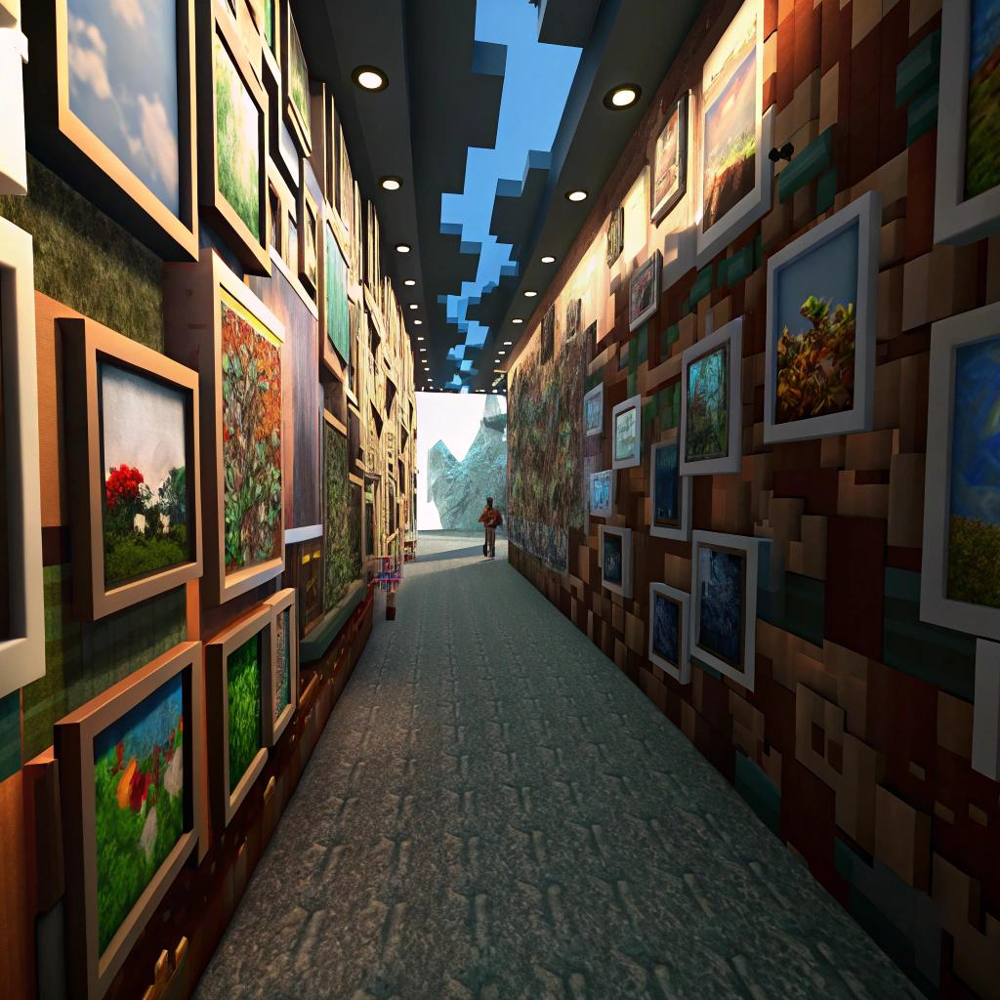
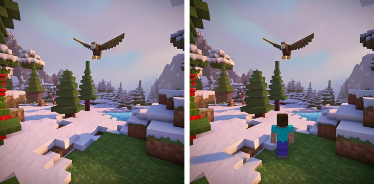
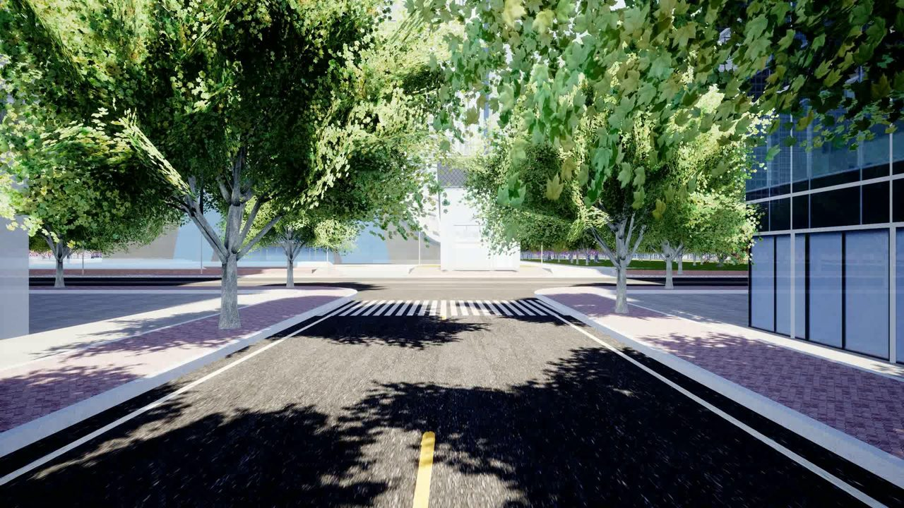
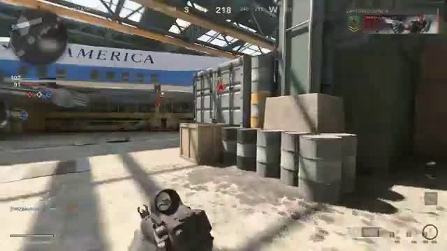
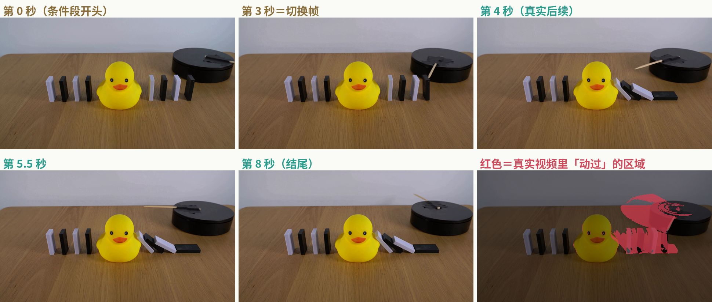
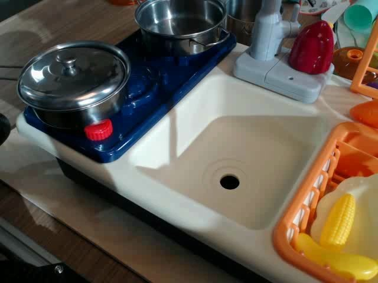
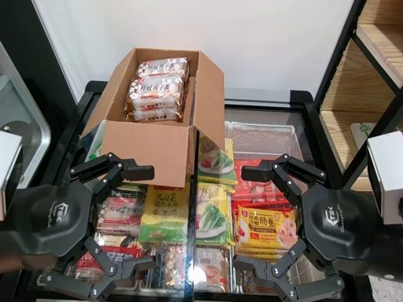
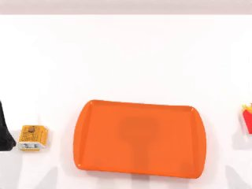
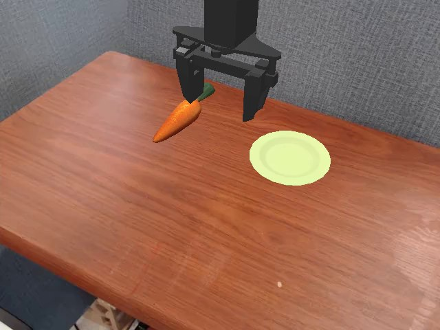

# 世界模型与视频生成榜单总览

> 阿汤 · 2026-10-10 · 把之前三份调研合成一页：[WBench 调研](../wbench/) · [Physics-IQ 调研](../physics-iq/) · [视频生成与控制榜单调研](../video-benchmarks/)。所有数字、参赛者、题目都摘自各榜官网、论文、GitHub、Hugging Face 原始文件（抓取时间 2026-10-09 至 10-10 美东），每个榜的卡片里都有原始链接。没查到的写「没查到」，没有补数。

## 一屏看懂

### 一共 30 个榜，分 5 类

| 类别 | 个数 | 一句话 |
|---|---|---|
| 🎨 [质量](#quality) | 6 | 画面好不好看、贴不贴提示词。行业「名片」，不考交互。 |
| 🎮 [可控交互](#control) | 9 | 按键、相机、指令能不能控住，前后是不是同一个世界。**和我们最对口。** |
| ⚛️ [物理](#physics) | 7 | 生成的东西符不符合物理规律，比如重力、碰撞、液体。 |
| ⚡ [实时](#realtime) | 1 | **没有专门的实时排行榜。**最接近的是 StreamAV-Bench，只列速度、不按速度排名。 |
| 🤖 [具身](#embodied) | 7 | 机器人相关：生成机器人操作视频，或者直接考机器人策略。 |

另有 MLPerf 文生视频（硬件榜，模型固定，比的是芯片）放在实时一节作参考，不计入 30 个。

### 核心结论

- **白模世界本身不能参加任何一个榜。**所有榜考的都是「模型」，题目固定，交的是模型生成的视频（或机器人策略）。没有一个榜收「自定义环境」。
- **白模世界的用处有三个：**
  1. **训练数据**：精确的相机轨迹、按键记录、物理真值（g、摩擦、碰撞时间）、机械臂末端轨迹。这些真实视频给不了。
  2. **内部模拟考**：照着榜的题型和指标，用白模出一套不重复的私有考题，有精确真值，提交前自查。
  3. **反过来自己做榜**：LIBERO、SimplerEnv、RoboDojo、WorldArena 本身就是「引擎场景 + 自动判分」，和白模世界是同一类东西。实时交互（按键到画面延迟）现在没有任何公开榜覆盖。

### 给我们的推荐（按优先级）

> **已确认：我们的模型支持三种控制——WASD 键移动、IJKL 键转视角（上下左右看）、文字指令。**
>
> **这和「逐帧 6 自由度相机位姿」有什么区别**：按键转视角是「按住 J 就以固定速度往左转，松开就停」，只能发几种离散命令，速度由模型自己定。6 自由度相机位姿是给模型每一帧的精确位置（前后、左右、上下三个方向）和朝向（左右转、上下看、侧滚三个角度），可以走任意曲线、任意变速，还包括侧滚和垂直升降。所以按键模型要考「给相机轨迹」的题，得先把轨迹换算成按键序列，并标定每个键每帧转多少度、走多远。

| 顺序 | 榜 | 为什么 |
|---|---|---|
| 1 | **[WBench](#wbench) Navi + Full 两个榜** | 唯一能让我们两种能力都上榜的地方。按键对 Navi 榜（158 道导航题，题里的方向键 ←→↑↓ 就是转视角，正好对应 IJKL）；文字对 Full 榜（289 道，多出角色动作、事件编辑、视角切换，这三类只有文字模型能做）。Full 榜现在一个按键模型都没有，前列全是文字模型（Murea-Pro 81.1）。免费、不用开源、发邮件即可，能挂 `realtime` 标签。 |
| 2 | **[WorldScore](#worldscore)**（从 ★★ 升回 ★★★） | 查了官方代码：相机路线只由 8 种动作拼成——前推、后拉、左移、右移、左摇 30°、右摇 30°、左右环绕 30°，没有上下看，也没有侧滚。前 6 种正好是 W、S、A、D、J、L，环绕要「横移 + 反向转头」组合键。题目和打分代码都公开，现在就能自己跑。视频模型相机控制只有 22–29 分，按键模型标定好转速后有机会拉开差距。要先做一个「相机路线 → 按键」转换器，见 [WorldScore 卡片](#worldscore)。 |
| 3 | **[WorldRoam-Bench](#worldroam)** | 考的就是 WASD + IJKL 视角键连续漫游 10–60 秒，官网列的参赛模型输入是「图 + 文字 + 按键」（Genie 3、快乐生蚝都是），和我们的接口一模一样。官网有提交表单。题目还没公开，只能先交视频、不能先自评。 |
| 4 | **[WorldMark](#worldmark)** | 统一 6 个键 W S A D L R，L/R 是左转/右转，正好对应 J/L，没有上下看；每个模型用适配器把按键翻译成自己的输入。题型和我们最像，但没有官方提交流程，适合自评、写进技术报告，或联系作者上 warena.ai 对战。 |
| 5 | **[Physics-IQ Verified](#physicsiq)** | 输入就是「开头画面 + 文字描述」，文字通道正好用上。前提是模型能在不给按键的情况下续写 5 秒、镜头不动。当「懂物理」的第二目标。 |
| 6 | **[WorldExam](#worldexam)**（题目公开后升到前三） | 有「离散动作」和「语言」两种控制通道，正好是我们的两种能力。动态交互赛道只收动作和语言模型，目标完成任务只收语言模型。但测试用例还没公开、没写怎么提交，现在打不了。 |
| 7 | **🤖 [WorldArena](#worldarena)** | 文字通道能参加（首帧 + 文字指令），「当数据引擎」赛道和我们定位贴。但它是机器人双臂操作，要在 RoboTwin 数据上专门微调，按键能力用不上。★★。 |

**评级变化**：WorldScore 从 ★★ 升回 ★★★（按键能覆盖它的相机动作，见卡片里的风险）；WorldArena 仍是 ★★；iWorld-Bench 仍是 ★★（有上下看和左右转，但缺侧滚、垂直升降，相机跟随任务要逐帧位姿）；CameraBench 仍是 ★，但可以拿来当我们转视角准不准的自动裁判；StreamAV-Bench 仍是 ★（要生成声音）；GameWorld Score 仍是 ★（鼠标视角可以用 IJKL 近似，但没有公开榜）。

**跳到：** [总表](#table) · [建议路线](#route) · [缺口](#gaps)

## 总表：30 个榜一行看懂

合适度按「WASD 移动 + IJKL 转视角 + 文字」模型评（已确认）：★★★ 优先打 · ★★ 值得看 · ★ 参考 · ✗ 不建议。点榜名跳到详细卡片。「还在维护」以 2026-10-10 查到的最近更新为准。

| 榜 | 类别 | 测什么 | 输入 → 输出 | 知名参赛者 · 当前第一 | 还在维护 | 怎么提交 | 合适度 |
|---|---|---|---|---|---|---|---|
| [VBench / VBench++ / 2.0](#vbench) | 🎨质量 | 1.0：16 维画质和语义；2.0：常识、物理、可控性等 18 维 | 文字（++ 加图）→ 视频 | Veo 3、Sora、Kling、Wan2.1 · 1.0 第一 HiDream-O1-Video 89.74；2.0 第一 Veo 3 66.72 | 在（最新条目 2026-08-07） | 传自评结果到排行榜 Space，或交视频/模型让团队评 | ★★ 名片榜，不考交互 |
| [T2V-CompBench](#t2vcomp) | 🎨质量 | 组合能力 7 类：属性、动态属性、空间、运动、动作、交互、数量 | 文字 → 视频 | PixVerse-V3、Kling-1.0、Gen-3 · 论文表里 PixVerse-V3 多数项最高 | 排行榜报错打不开 | 原表单不可用 | ★ |
| [EvalCrafter](#evalcrafter) | 🎨质量 | 700 条提示词、17 个客观指标 | 文字 → 视频 | Gen-2、Pika · Gen2（23/12）254 | 停更（2024） | 无 | ✗ |
| [FETV](#fetv) | 🎨质量 | 619 条细分类提示词 + 人评 | 文字 → 视频 | 4 个早期开源模型 | 无榜 | 无 | ✗ |
| [Artificial Analysis Video Arena](#aa) | 🎨质量 | 招募评审盲选两段视频 → Elo | 文字/图 → 视频 | Seedance 2.5、Veo 3.1、Kling 3.0 · 第一 Wan 3.0 1156 | 在（每小时） | 只收有公开 API 的模型，官网申请 | ★ |
| [LMArena Text-to-Video](#lmarena) | 🎨质量 | 公众自写提示词盲投 | 文字 → 视频 | sora-2-pro、veo-3.1 · 第一 gemini-omni-1.1-flash 1516 | 在（2026-09-21） | 没查到 | ★ |
| [WBench](#wbench) | 🎮可控交互 | 多轮交互：导航、角色动作、事件编辑、视角切换 | 首帧 + 多轮操作（按键/相机/文字）→ 视频 | Zing-0.5、Kling 3.0、快乐生蚝、Genie 3 · Navi 第一 Alaya-EVOKE-Turbo 82.0；Full 第一 Murea-Pro 81.1 | 在（2026-10-04） | 生成视频 → 自评或官方免费评 → 网盘 + 邮件，人工审核 | ★★★ 按键打 Navi（方向键＝IJKL 转视角）、文字打 Full |
| [WorldScore](#worldscore) | 🎮可控交互 | 按指定相机轨迹连续生成多个场景：相机控制、3D 一致、动态 | 起始图 + 相机路径 + 分段文字 → 视频/3D | Voyager、Gen-3、Wan2.1、Hailuo · 第一 UniWorld-View 85.53 | 在（2026-07-23） | 自评后把 worldscore.json 发邮件，或交视频让作者评 | ★★★（升回）相机路线只有前推/后拉/横移/左右摇/环绕，可换算成 WASD + J/L；要标定转速 |
| [WorldMark](#worldmark) | 🎮可控交互 | 统一按键 W S A D L R，9 个确定性指标（动作、记忆、画质） | 首帧 + 按键序列 → 20–60 秒视频 | Matrix-Game 3.0、Lyra 2.0、HY-World 1.5 · 没有总分 | 基本在（2026-08-05） | 没写，要联系作者 | ★★★ 6 键含左右转，正好 WASD + J/L；但只能自评 |
| [iWorld-Bench](#iworld) | 🎮可控交互 | 6 自由度相机动作 + 绕圈回原点的记忆 | 首帧 + 相机动作 → 视频 | Matrix-Game 2.0、Cosmos · 第一 HY-World 1.5 0.7873 | 代码在更新，榜只有论文 14 个模型 | 没写 | ★★ IJKL 覆盖左右转和上下看，缺侧滚、垂直升降；没提交入口 |
| [WorldRoam-Bench](#worldroam) | 🎮可控交互 | 10–60 秒连续 WASD 漫游：跟动作、画质、交互物理、记忆 | 首帧 + WASD/IJKL → 长视频 | Lyra 2.0、快乐生蚝 · 第一人称第一 Genie 3 70.32 | 在（2026-09-18） | 官网表单上传视频（≤5GB） | ★★★ 考的就是 WASD + IJKL，输入和我们一样 |
| [WorldExam](#worldexam) | 🎮可控交互 | 三种控制 + 「世界会不会自己反应」 | 首帧 + 相机/离散动作/语言 → 视频 | Kling 2.5、Seedance 1.5 · 静态第一 NeoVerse 85.39；动态第一 Veo 3.1 72.77 | 题库未公开（2026-08） | 没写 | ★★ 离散动作 + 语言两通道都对口，题目公开后升 ★★★ |
| [WorldModelBench](#wmb) | 🎮可控交互/物理 | 7 领域 350 题：指令跟随 + 物理 + 常识 | 文字 + 首帧 → 视频 | Minimax、Runway · 第一 KLING 9.10 | 停（2024-11） | 发邮件 | ✗（裁判模型可当质检） |
| [GameWorld Score](#gameworld) | 🎮可控交互 | Minecraft 键盘/鼠标操作准确率 | 键鼠 → 视频 | Oasis、MineWorld · Matrix-Game 键盘/鼠标 0.95 | 只有论文自评 | 无 | ★ 鼠标视角可用 IJKL 近似，但没有公开榜 |
| [CameraBench](#camerabench) | 🎮可控交互（理解） | 看视频判断相机怎么动（不是生成） | 视频 → 相机运动标签 | COLMAP、GPT-4o · MegaSaM 最好 | 联系作者加入 | 联系作者 | ★ 可当我们转视角准不准的自动裁判 |
| [Physics-IQ Verified](#physicsiq) | ⚛️物理 | 66 个真实桌面实验，看开头续写 5 秒 | 3 秒视频（V2V）或 1 帧（I2V）+ 文字 → 5 秒视频 | FLUX 3、Cosmos3、Veo 3.1、Sora 2 · V2V 第一 Odyssey-3 Pro 66.10；I2V 第一 FLUX 3 54.70 | 在（2026-10-08 合并新成绩） | GitHub 联系拿上传凭证 → 交视频 + 技术报告，主办方重算 | ★★ 文字通道可用，要能不给按键续写、镜头不动 |
| [PhyGenBench](#phygen) | ⚛️物理 | 27 条物理定律 160 题，VLM 分层判 | 文字 → 视频 | Kling、Pika · 第一 Gen-3 0.51 | 停（2024） | 无 | ✗ |
| [VideoPhy-2](#videophy) | ⚛️物理 | 体育/物体交互动作的物理常识，人评为主 | 文字 → 视频 | Sora、Ray2 · 第一 Wan2.1-14B 32.6% | 没查到更新时间 | 发邮件交 CSV | ★ |
| [T2VPhysBench](#t2vphys) | ⚛️物理 | 12 条物理定律，纯人工打分 | 文字 → 视频 | Kling、Sora · 第一 Wan 2.1 0.42 | 只有论文 | 无 | ✗ |
| [WorldBench / PerfectPhysics](#worldbench) | ⚛️物理 | 从生成视频里反算 g、摩擦系数、黏度 | 首帧/前段视频 → 续写 | Kling 3.0、Runway 4.5、Wan 2.2 · g 最接近真值的是 Cosmos-2 2B 8.93 | 无公开榜（2026-01 论文） | 无，自评 | ★★ |
| [PAI-Bench](#paibench) | ⚛️物理 | 1044 道图生视频题（含机器人、自动驾驶）+ 是非题裁判 | 文字 + 图 → 视频 | Veo-3、Wan2.2 · 第一 Cosmos3-Super 83.9 | 在（2026-08-18） | 自跑评测后联系作者 | ★★ |
| [PhysBench](#physbench) | ⚛️物理（理解） | 1 万道物理理解题，考 VLM | 图/视频 → 答案 | GPT-4o 49.49 · 模型最高 InternVL2.5-38B 51.94 | 没查到 | EvalAI | ✗ |
| [StreamAV-Bench](#streamav) | ⚡实时 | 流式音视频生成：FPS、首段延迟、中途改指令多久跟上 | 文字 + 中途指令 → 180 秒音视频流 | 快乐生蚝、Odyssey-2、Self-Forcing · 速度不排名；FPS 最高 Self-Forcing 15.63 | 榜最后更新 2026-08-28 | 没写 | ★ 中途改文字指令对口，但要带声音 |
| [EWMBench](#ewmbench) | 🤖具身 | 机器人操作视频，和真录像比场景/轨迹/语义 | 首帧 + 指令 → 视频 | Kling-1.6、Cosmos · 第一 EnerVerse_FT 4.7010 | 无在线榜，代码 2025-06 后没动 | 无，自评 | ★★ |
| [WorldArena](#worldarena) | 🤖具身 | RoboTwin 双臂任务：视频质量 + 当数据引擎/策略评估器/规划器 | 首帧 + 文字或动作序列 → 视频 | Veo3.1、Wan2.6、Cosmos · 1.0 第一 UNIS 73.64（复算） | 在（IROS 2026 挑战赛进行中） | 按提交说明本地评测；新成绩走 2.0 挑战赛 | ★★（原 ★★★）文字通道能参加，但要专门做机器人数据 |
| [WorldEval](#worldeval) | 🤖具身 | 用世界模型代替真机给机器人策略打分（方法论文） | — | 被评对象 π0、OpenVLA 等 | 无榜 | 不能参赛 | ✗ |
| [RoboDojo](#robodojo) | 🤖具身 | 机器人策略：42 仿真 + 18 真机任务 | 观测 + 指令 → 机器人动作 | GPT-6-Astra、π0.5 · 仿真第一 VPP2 39.26 / 32.26% | 非常活跃（2026-10-09） | XPolicyLab 适配器 PR + 评测申请 | ★ |
| [RoboArena](#roboarena) | 🤖具身 | 多所高校真机双盲 A/B 对战 | 策略在 DROID 平台上执行 | DreamZero、π0.5 · 第一 Spirit v1.6 1788 | 在（2026-10-10） | 官网 Google 表单 | ★ |
| [LIBERO](#libero) | 🤖具身 | 130 个仿真操作任务的成功率 | 观测 + 指令 → 机器人动作 | π0 94.2 · OpenVLA-OFT 97.1（论文自报） | 无官方榜 | 无 | ✗ 快刷满 |
| [SimplerEnv](#simplerenv) | 🤖具身 | 仿真复刻真机，看仿真分能否代替真机分 | 观测 + 指令 → 机器人动作 | RT-1、Octo（原论文） | 代码在维护（2026-09-30），无官方榜 | 无 | ✗ |

## 🎨 质量类（6 个）

画面好不好看、贴不贴提示词。都不考交互；还在更新的只有 VBench、Artificial Analysis、LMArena。等模型画质够了再打，用来证明「画质不掉队」。

### VBench / VBench++ / VBench-2.0 —— 行业最常引用的文生视频评测
**谁做的**：上海人工智能实验室 + 南洋理工 S-Lab（刘子纬组）。VBench 发表于 CVPR 2024（[arXiv 2311.17982](https://arxiv.org/abs/2311.17982)）；VBench++ 扩展到图生视频（[arXiv 2411.13503](https://arxiv.org/abs/2411.13503)，TPAMI）；VBench-2.0 于 2025 年 3 月发布（[arXiv 2503.21755](https://arxiv.org/abs/2503.21755)）。
链接：[官网](https://vchitect.github.io/VBench-project/) · [GitHub](https://github.com/Vchitect/VBench) · [排行榜（HF Space）](https://huggingface.co/spaces/Vchitect/VBench_Leaderboard)
**还在维护吗**：在。GitHub 最近一次提交 2026-08-21，排行榜最新一条是 2026-08-07 的 HiDream-O1-Video。

**测什么**
- **VBench 1.0**：文生视频，16 个维度（主体一致性、背景一致性、运动平滑、动态程度、美学、成像质量、物体类别、多物体、人物动作、颜色、空间关系、场景、风格、整体一致性等），**946 条提示词**。全部自动评分：每个维度用专门的检测/分割/CLIP 类模型算分。
- **VBench++**：增加图生视频（I2V）赛道，考「生成的视频和输入图像是否一致」。
- **VBench-2.0**：从「好不好看」转向「真不真实」，5 大类 18 个维度：创造力、常识、可控性、人物真实度、物理，**1013 条提示词**。很多维度用多模态大模型回答是非题来判。
- **认证等级**：Gold＝VBench 团队自己采样并评测；Silver＝提交方采样、VBench 团队评测。

**谁打了这个榜（原表摘录）**

VBench 1.0 文生视频榜（73 条）：

| 名次 | 模型 | 总分 |
|---|---|---|
| 1 | HiDream-O1-Video（2026-08-07） | 89.74 |
| 2 | IPOW | 88.26 |
| 3 | Vidu Q1 | 87.41 |
| 4 | IPOC | 86.57 |
| 5 | JT3.5 | 86.47 |
| 6 | Wan2.1 | 86.22 |
| 8 | MiracleVision V5（美图） | 85.23 |
| 9 | **Veo 3**（Gold，VBench 团队采样） | 85.06 |
| 10 | LanDiff | 84.87 |

其他知名模型：Open-Sora-2.0 84.34、**Sora 84.28**、**Luma 83.61**、**Hunyuan Video 83.43**、**MiniMax-Video-01 83.41**、**Kling 1.6 83.40**、**Runway Gen-3 82.32**、Pika-1.0 80.69、LTX-Video 80.00。

VBench-2.0 榜（12 条）：**Veo 3 66.72**、JT-CV 64.60、ABot-World v0.1（高德）64.47、Vidu Q1 62.70、ToMoviee 2.0 61.78、Wan2.1 60.20、**Seedance 1.0 Pro 59.81**、Kling 1.6 59.00、Sora-480p 58.38、StepVideo 55.78、HunyuanVideo 55.30、CogVideoX-1.5 53.35。

VBench++ 图生视频榜（35 条）前列：DreamX-World-1.0 90.49、ToMoviee-2.0 89.76、Steamer-I2V 89.38、Magi-1 89.28、Pi 89.08、JT-CV 88.95、Wan2.2-TI2V-5B 88.80、Wan2.2-I2V-A14B 88.68；Runway Gen-4-I2V 88.27、HunyuanVideo-I2V 86.82。

**完整真题示例 ①（VBench 1.0，维度「空间关系」）**
- 提示词原文：`a bicycle on the left of a car, front view`
- 中文：一辆自行车在一辆汽车的左边，正面视角。
- 题目附带的标注：object_a＝bicycle，object_b＝car，relation＝on the left of。
- 怎么打分：用检测模型在每帧里框出自行车和汽车，按两者框的相对位置判断「自行车是否在左边」，逐帧算分再平均。

**完整真题示例 ②（VBench-2.0，维度「力学 Mechanics」，该维度共 57 题）**
- 提示词原文：`A bowl of soup is tilted in the space station, with the liquid slowly spreading in all directions.`
- 中文：在空间站里倾斜一碗汤，汤液缓慢地向四面八方散开。
- 裁判问题（多模态大模型回答 yes/no）：
  - `Is the background of the video a space station? (yes or no)`（背景是空间站吗？）
  - `Does the liquid form floating blobs and spread in all directions? (yes or no)`（液体是否形成漂浮的液团并向四周散开？——失重下不该往下流）
- 两题都答「是」才算这题过。

**怎么提交**：README 给了三种方式：上传自评的 result.json 到排行榜 Space；或把视频交给 VBench 团队评（Silver）；或让团队直接采样（Gold，需提供模型/API）。联系邮箱写在 README 里（ZIQI002@e.ntu.edu.sg）。
**和我们的关系**：行业「名片」榜，但完全不考相机、按键交互；白模画面偏素，在美学/成像质量上不占优。适合等模型画质够了再打，用来对外证明「画质不掉队」。

### T2V-CompBench —— 组合能力（属性、空间、数量……）
**谁做的**：港大（刘希慧组）+ 港中文 + 华为诺亚，CVPR 2025（[arXiv 2407.14505](https://arxiv.org/abs/2407.14505)）。[官网](https://t2v-compbench-2025.github.io/) · [GitHub](https://github.com/KaiyueSun98/T2V-CompBench)（V2 分支最近提交 2025-10-25）· [排行榜 Space](https://huggingface.co/spaces/Kaiyue/T2V-CompBench_Leaderboard)
**还在维护吗**：**排行榜挂了**——2026-10-10 打开是 RUNTIME_ERROR（HF token 失效），看不到在线排名。下面用论文表。

**测什么**：1400 条提示词，7 类各 200 条：属性一致、**动态属性（随时间变化）**、空间关系、运动、动作、交互、数量。提示词从 167 万条真实用户提示词里提炼。评分全自动：多模态大模型（Grid-LLaVA、D-LLaVA）、检测（GroundingDINO）、跟踪（DOT）。

**谁打了（论文表 2，23 个模型，0–1 分，列出前几列）**

| 模型 | 属性一致 | 动态属性 | 空间 | 运动 | 动作 | 交互 | 数量 |
|---|---|---|---|---|---|---|---|
| PixVerse-V3 | .7060 | .0624 | .5979 | .2867 | .8722 | .8309 | .6066 |
| **Kling-1.0** | .6931 | .0098 | .5690 | .2562 | .5787 | .7128 | .4413 |
| Dreamina 1.2（字节） | .6913 | .0051 | .5773 | .2361 | .5924 | .6824 | .4380 |
| T2V-Turbo-V2 | .6723 | .0127 | .5025 | .2556 | .6087 | .6439 | .3261 |
| CogVideoX-5B | .6164 | .0219 | .5172 | .2658 | .5333 | .6069 | .3706 |
| **Runway Gen-3** | .5980 | .0687 | .5194 | .2754 | .5233 | .5906 | .2306 |
| Mochi | .5973 | .0246 | .5480 | .2334 | .4759 | .5381 | .2718 |
| Pika-1.0 | .5536 | .0128 | .4650 | .2234 | .4250 | .5198 | .3870 |

**完整真题示例（动态属性类）**
- 提示词：`A timelapse of a leaf transitioning from green to bright red as autumn progresses.`
- 中文：延时摄影：随着秋天推进，一片叶子从绿色变成鲜红色。
- 标注：state0＝`A green leaf`（一片绿叶），state1＝`A bright red leaf`（一片鲜红的叶子），类型＝属性变化。
- 打分：D-LLaVA 逐帧判断画面更像 state0 还是 state1，要求随时间从 0 平滑过渡到 1。

**怎么提交**：本来是把评测 CSV 打包传到排行榜 Space 表单，**现在表单不可用**。
**和我们的关系**：低。不考交互，榜也挂了。

### EvalCrafter —— 已停更
**谁做的**：腾讯 AI Lab 等，CVPR 2024（[arXiv 2310.11440](https://arxiv.org/abs/2310.11440)）。[GitHub](https://github.com/evalcrafter/EvalCrafter)（最近提交 2024-10-03）；排行榜 Space（AILab-CVC/EvalCrafter）是 BUILD_ERROR，最后修改 2024-04-11。
**测什么**：700 条提示词，约 17 个客观指标归成 4 方面（画质、文本贴合、运动质量、时间一致性），再按 8.6k 条人工反馈加权。
**谁打了**（仓库里的 result.csv，2023–24 年）：Gen2（23/12）254、PikaLab V1.0 250、Gen2（23/09）244、VideoCrafter2 243、LaVie-Interp 241、MoonValley 241……没有任何 2025 年以后的模型。
**真题示例**：prompt700.txt 第 300 行原文 `With the style of da Vinci, A woman gently pets a cat purring in her lap.`（达·芬奇风格：一位女士轻抚躺在她腿上呼噜的猫。）——按 17 个指标（如 CLIP 文本贴合、风格、运动幅度等）自动打分。
**和我们的关系**：不建议，已停更。

### FETV —— 只有论文人评，没有榜
**谁做的**：北大（孙栩组）+ 华为诺亚，NeurIPS 2023 数据集赛道（[arXiv 2311.01813](https://arxiv.org/abs/2311.01813)）。[GitHub](https://github.com/llyx97/FETV)（最近提交 2024-03-04）· [数据](https://huggingface.co/datasets/lyx97/FETV)
**测什么**：619 条提示词，按「主要内容 / 属性控制 / 提示词复杂度」细分类；人工评 4 个早期模型（CogVideo、Text2Video-zero、ModelScopeT2V、ZeroScope）的静态质量、时间质量、整体贴合、细粒度贴合。**没有排行榜**。
**完整真题示例**：`{"video_id":"1006807024","prompt":"A mountain stream","major content":{"spatial":["scenery & natural objects"],"temporal":["fluid motions"]},"prompt complexity":["simple"],"source":"WebVid"}`——提示词「一条山涧溪流」，空间类别＝风景与自然物，时间类别＝流体运动，复杂度＝简单。人工按 4 项打分。
**和我们的关系**：不建议。

### Artificial Analysis Video Arena —— 商用模型盲评竞技场
**谁做的**：Artificial Analysis（独立评测公司）。[文生视频榜](https://artificialanalysis.ai/video/leaderboard/text-to-video) · [方法说明](https://artificialanalysis.ai/methodology/video)
**还在维护吗**：在，每小时更新。

**测什么**：招募的评审（Prolific 平台）看同一提示词下两个匿名视频，选更好的；用 Bradley-Terry 算 Elo，**以 Kling 3.0 1080p Pro＝1000 为锚点**。6 个榜：文生视频 v2.0（带声音）、文生视频-无声 v2.0、图生视频（带声/无声）v1.0、视频编辑（带声/无声）v1.1。文生视频 v2.0 用 1000 条提示词（无声版 500 条），按「用途 × 能力」分类，能力包括物理、复杂构图、人体结构、光照、多镜头、相机控制、文字渲染、时空一致性、音画同步、口型同步，外加 8 种风格。默认 1080p、24fps、10 秒、16:9、seed 42。约 1/5 的对局是质检题。**提示词不公开**。

**谁打了（文生视频 v2.0，2026-10-10）**

| 名次 | 模型 | Elo |
|---|---|---|
| 1 | **Wan 3.0**（阿里） | 1156 |
| 2 | Utopai X | 1149 |
| 3 | **Dreamina Seedance 2.5**（字节） | 1143 |
| 4 | **MiniMax H3 768p**（开放权重第一） | 1137 |
| 5 | MiniMax H3 Max | 1130 |
| 6 | FLUX 3 | 1128 |
| 7 | Seedance 2.0 | 1116 |
| 8 | **Gemini Omni Flash 1.1**（Google） | 1113 |
| 9 | SkyReels V4 | 1074 |
| 10 | Agnes-Video-2.5 | 1057 |

其后：Grok Imagine Video 1.5 1045、HappyHorse-1.1 1042、Wan2.7 1030、**Kling 3.0 Omni 1015**、Kling 3.0 Pro 1000（锚点）、PixVerse V6 985、**Veo 3.1 962**、MAGI-2 Preview 960、LTX-2.5 946、Vidu Q3 Pro 941。共 29 个。**这个榜上没有 Sora、Runway、Luma**。

**真题示例**：提示词不公开，**拿不到真题**。
**怎么提交**：只收有公开、无服务器 API 的模型，按「行业重要性」由 AA 决定是否收录，通过官网联系页申请。
**和我们的关系**：只有我们出公开 API 的商用视频模型才有意义，不考交互。

### LMArena Text-to-Video —— 公众投票竞技场
**链接**：[lmarena.ai/leaderboard/text-to-video](https://lmarena.ai/leaderboard/text-to-video)。2026-09-21 更新，71.9 万票，48 个模型。
**测什么**：普通用户自己写提示词，看两个匿名视频投票，算类 Elo 分。
**谁打了**：1 gemini-omni-1.1-flash 1516；2 gemini-omni-flash 1513；3 flux-3-video 1493（初步）；4 grok-imagine-video-1.5-agent 1492（初步）；5 dreamina-seedance-2.0-720p 1479；6 wan3.0 1476；7 seedance-2.5-720p 1474；8 minimax-h3 1460；9 muse-video（Meta）1456；10 happyhorse-1.0 1427；11 **sora-2-pro 1368**；12 **veo-3.1-audio 1364**；17 sora-2 1343；27 **runway-gen-4.5 1225**；29 **kling-2.6-pro 1216**；31 **ray-3（Luma）1206**；32 **hailuo-2.3 1206**；38 hunyuan-video-1.5 1169；42 wan-v2.2-a14b 1132。
**真题示例**：题目是用户临时写的，**没有固定题库**。
**和我们的关系**：同 AA，偏商用模型曝光。

## 🎮 可控交互类（9 个）

按键、相机、指令能不能控住，前后是不是同一个世界。**和我们最对口**，推荐前四都在这一类：WBench（Navi 用按键、Full 用文字）、WorldScore（相机路线换算成按键）、WorldRoam-Bench、WorldMark。

### WBench —— 多轮交互式世界模型评测（美团 + 复旦）

**谁做的**：复旦大学（丁恒辉组）+ 美团 LongCat 团队，2026-05-28 论文、数据、代码、榜单同时发布。
链接：[官网与榜单](https://meituan-longcat.github.io/WBench/#leaderboard) · [论文 arXiv 2605.25874](https://arxiv.org/abs/2605.25874) · [GitHub](https://github.com/meituan-longcat/WBench)（MIT）· [数据](https://huggingface.co/datasets/meituan-longcat/WBench)（公开）· [提交说明](https://github.com/meituan-longcat/WBench/blob/main/docs/SUBMISSION.md)
**还在维护吗**：在。官网标注「Leaderboard Updated 2026/10/04」。
**完整版**：全部榜单、22 个小指标的前三、17 道原题见 [WBench 单独页面](../wbench/)。

**测什么**：给世界模型一张起始画面和一串多轮操作（往前走、左转、让角色做动作、让环境变化、切第一/第三人称），看生成的视频好不好看、听不听话、前后一不一致、物理合不合理。289 道题、1,058 轮：导航 601 轮、角色动作 213、事件编辑 183、视角切换 61。第一人称 178 道、第三人称 111 道；写实 150、风格化 139。

**五个维度**（每维 0–100，总分 = 五维等权平均，全部自动打分，不用人评）：画质、设定贴合、交互、一致性、物理。导航分（NavScore）是用 MegaSAM 从视频反推相机轨迹，和按键对应的标准轨迹比。

**有哪些榜**（真正有排名的只有两个，官网可再按模型类型、维度、小指标筛）：

| 榜 | 题量 | 谁能参加 | 当前前三（官网 2026/10/04） |
|---|---|---|---|
| **Navi 导航榜** | 158 题 | 文字、相机、按键都能参加，共 42 个模型 | Alaya-EVOKE-Turbo 82.0；XGEN-Jing 81.9；Enuma（字节，未发布）81.7 |
| Navi · 只看按键模型 | 158 | 10 个 | JoyAI-Echo-1.5 81.6；JoyAI-Echo-1.5 flash 81.0；**Zing-0.5 81.0** |
| Navi · 只看文字模型 | 158 | 12 个 | Kling 3.0 79.0；Wan 2.7 78.1；HY-Video 1.5 77.9 |
| **Full 全量榜** | 289 题 | 官方说只有文字模型；但现在榜上有 3 个相机模型，共 16 个 | Murea-Pro 81.1；XGEN-Jing 81.0；XGEN-Jing 4-step AR 79.9 |

Navi 榜参照位置：Zing-0.5 第 6（81.0）、Kling 3.0 第 13（79.0）、快乐生蚝 第 19（76.8）、Genie 3 第 32（73.9）。前 10 名分差只有 2.1 分。

**两个对打榜有用的发现**（官网 Key Findings）：导航能力和画质、物理几乎不相关；多轮误差会累积，导航准确度从第 1 轮到第 4 轮掉 21 分。

**一道完整原题（case 179 · 导航 · 闭环 · 第一人称 · 写实）** [原始 JSON](https://huggingface.co/datasets/meituan-longcat/WBench/blob/main/cases/case_179.json)

- **场景**（中文翻译）：黄昏时热闹的东南亚夜市。一条窄巷两侧是小吃摊，挂着彩色篷布和一串串暖黄灯泡。炒锅、炭烤架和汤锅冒出白色蒸汽和烟。地面刚下过雨，映着暖色灯光。左边摊位在炭火上烤沙爹串，右边水果摊的热带水果摆在碎冰上。前方小巷继续深入，更多摊位卖汤面和烤海鲜，头顶挂着中式灯笼。左边有小岔巷通向布料摊和饰品店；右边摊位缝隙里能看到摩托车和塑料箱。观察者身后，市场入口通向大路，有突突车和霓虹招牌。
- **视角**：第一人称，站在拥挤过道中间，镜头在头部高度向前看，看不到角色身体。

| 轮 | 原题 | 中文 | 文字模型实际收到 |
|---|---|---|---|
| 1 | 按键 `W` | 镜头前推 | The camera pushes forward. |
| 2 | 按键 `A` | 镜头左移 | The camera moves to the left. |
| 3 | 按键 `D` | 镜头右移 | The camera moves to the right. |
| 4 | 按键 `S` | 镜头后拉 | The camera pulls back. |

- **算什么分**：所有题都算的 11 项（6 个画质指标、背景一致、片段连续、几何一致、光度一致、视觉合理性），这道题另外算：导航轨迹（反推相机轨迹和标准轨迹比）；空间一致（最后回到起点那一帧和第一帧像不像）；门控空间一致（同上，但画面几乎不动的扣分，防止靠静止刷分）；场景贴合（大模型判场景元素有没有保持，转过去后「画外」描述的东西有没有出现，比如身后的大路、突突车和霓虹招牌）。

**怎么提交**（[SUBMISSION.md](https://github.com/meituan-longcat/WBench/blob/main/docs/SUBMISSION.md)）：

1. 从 HuggingFace 下题目，用自家模型每题生成一段视频（相机/按键模型做 158 道导航题，文字模型做全部 289 道）。
2. 二选一：**A. 自己评**（要 GPU 和火山引擎豆包 API key，官方抽样复核）；**B. 交视频让官方免费评**（排队）。
3. 打包 `meta.json` + 视频 + 建议附 `turns.json`（不交就按轮数平均切，自回归模型会吃亏）。
4. 视频放 HuggingFace 数据集或网盘，发邮件给 kaining.ying.cv@gmail.com 和 rensiyu07@meituan.com，标题 `[WBench Submission] <展示名>`，人工审核。
5. **不用交权重、不用开 API、免费**。要挂 `realtime` 标签，邮件里须写硬件、分辨率和实测速度。

**和我们的关系**：★★★（WASD + IJKL + 文字模型）。我们两种能力都能用上：按键模型上 Navi 榜（158 道；题里的方向键 ←→↑↓ 是转视角，第一人称下是镜头左右转、上下看，正好对应 IJKL，W+left 这类组合键要求移动和转头同时按），文字模型上 Full 榜（289 道，角色动作、事件编辑、视角切换只有文字模型能做）。Full 榜现在没有按键模型，按「只看按键」筛是空的，前列全是文字模型（Murea-Pro 81.1、Kling 3.0 79.4）。⚠️ 没查到同一个模型能不能用「按键」和「文字」两种类型各交一次（`meta.json` 里只能填一个类型），要发邮件问作者。白模的精确相机轨迹和按键记录正对「导航」，大批量「走一圈回原点」正对空间一致。风险：一半题是写实图，白模画面偏素可能拉低画质和设定贴合；物理分是大模型判的，不是引擎真值；289 道题全公开，没找到明文禁止拿测试题训练，建议内部定死「不许用 WBench 的图、文字、轨迹训练或调参」。

### WorldScore —— 按相机轨迹「一段段造世界」
**谁做的**：斯坦福（段浩一、Koven Yu、Sirui Chen、**李飞飞**、吴佳俊），ICCV 2025（[arXiv 2504.00983](https://arxiv.org/abs/2504.00983)）。
链接：[官网](https://haoyi-duan.github.io/WorldScore/) · [GitHub](https://github.com/haoyi-duan/WorldScore) · [数据](https://huggingface.co/datasets/Howieeeee/WorldScore)（MIT 协议）· [排行榜](https://huggingface.co/spaces/Howieeeee/WorldScore_Leaderboard)
**还在维护吗**：在。GitHub 最近提交 2026-07-23，排行榜最新条目同日（UniWorld-View）。

**测什么**：把「生成世界」拆成**按明确相机轨迹的连续下一场景生成**——给一张起始图、一条相机路径（比如先左摇、再左移、再拉远）和每一段的场景描述，模型要一段段生成，镜头走到哪、场景就得变到哪，而且前后得是同一个世界。3D 生成、4D 生成、图生视频、文生视频都能参加。
- 题量：静态 2000 + 动态 1000 = **3000 题**。
- 指标全自动：
  - **可控性**：相机控制（用 DROID-SLAM 从生成视频里反算相机轨迹，和指定轨迹比）、物体控制（GroundingDINO+SAM 看要求的物体出没出现）、内容贴合；
  - **质量**：3D 一致性、光度一致性、风格一致性、主观质量；
  - **动态**（只算 Dynamic 榜）：运动准确度、运动幅度、运动平滑。
- 两个总分：**WorldScore-Static**（可控+质量）和 **WorldScore-Dynamic**（再加动态）。

**谁打了（排行榜 35 条，按 Static 排）**

| 名次 | 模型 | 类型 | Static | Dynamic | 相机控制 |
|---|---|---|---|---|---|
| 1 | UniWorld-View（北大袁粒组，2026-07-23） | 4D | 85.53 | 76.09 | 97.72 |
| 2 | WorldScape-0.2 (MoE) | 视频 | 85.13 | 76.23 | 94.32 |
| 3 | World Dreamer | 4D | 84.52 | 74.35 | 91.62 |
| 4 | EvoPhys-World | 视频 | 83.45 | 73.78 | 94.56 |
| 5 | Inspatio-World | 4D | 83.15 | 74.10 | 93.51 |
| 6 | WorldScape-0.2 | 视频 | 81.37 | 73.62 | 75.47 |
| 7 | EonWorld | — | 81.08 | — | — |
| 8 | WorldScape-0.1 | — | 80.76 | — | — |
| 9 | FantasyWorld-1.0 | — | 80.45 | — | — |
| … | **Voyager（腾讯混元）** | 3D | 77.62 | 54.53 | 85.95 |
| … | WonderWorld | 3D | 72.69 | — | — |
| … | CogVideoX-I2V | 视频 | 62.15 | — | — |
| … | **Runway Gen-3** | 视频 | 60.71 | 57.58 | **29.47** |
| … | **Wan2.1** | 视频 | 57.56 | 52.85 | **23.53** |
| … | **Hailuo（MiniMax）** | 视频 | 57.55 | 56.36 | **22.39** |
| … | LTX-Video | 视频 | 55.44 | — | — |

**最关键的一个发现**：普通视频模型（Gen-3 / Hailuo / Wan）相机控制只有 22–29 分，3D/4D 世界模型在 85–97 分。也就是说「听相机指挥」这件事，视频模型普遍不行——这正是白模世界最能给的训练信号（精确相机位姿）。

**完整真题示例（静态集第 1280 题，风格化 · 室内 · 走廊类 · Minecraft 风格）**

- 相机路径：`["pan_left", "move_left", "pull_out"]`（向左摇 → 向左平移 → 拉远）
- 4 段场景（content_list）：
  1. `Art Gallery Corridor, wall of framed pictures`（美术馆走廊，一面挂满画框的墙）
  2. `Outdoor Sculpture Garden, interactive sculpture, stone pathway`（户外雕塑园，互动雕塑，石板小路）
  3. `Sunlit Garden Reflection Pool, reflection pool, sculptural fountain`（阳光花园倒影池，倒影池，雕塑喷泉）
  4. `Tranquil Meadow Overlook, meadow of wildflowers, gentle stream`（静谧草地观景台，野花草地，潺潺小溪）
- 每段提示词（prompt_list）：
  1. `In the Art Gallery Corridor, walk through the sleek, modern hallway adorned with a wall of framed pictures extending into the distance.`（在美术馆走廊里，穿过时尚现代的走廊，一面挂满画框的墙一直延伸到远处。）
  2. `In an Outdoor Sculpture Garden, a vibrant interactive sculpture invites exploration as visitors meander along the winding stone pathway.`（户外雕塑园里，一座鲜艳的互动雕塑吸引人探索，游客沿着蜿蜒的石板路漫步。）
  3. `Sunlit Garden Reflection Pool: A tranquil reflection pool mirrors the sculptural fountain, casting shimmering patterns as sunlight dances across the water's surface.`（阳光花园倒影池：平静的池水倒映着雕塑喷泉，阳光在水面跳动，投下闪烁的光纹。）
  4. `In the "Tranquil Meadow Overlook," a vibrant meadow of wildflowers stretches wide as a gentle stream winds gracefully through the lush landscape.`（在「静谧草地观景台」，一片绚烂的野花草地铺展开来，一条小溪在葱郁的景色中蜿蜒流过。）
- 算什么分：每段之间的相机运动是否真的是「左摇 / 左移 / 拉远」（DROID-SLAM 反算）；每段要求的物体（画框墙、雕塑、喷泉、小溪）有没有出现；四段拼起来 3D 结构、光照、Minecraft 风格是否一致；画面主观质量。

**怎么提交**：自己跑开源评测，把 worldscore.json 发邮件给作者（haoyiduan@princeton.edu）；也可以把视频发过去让作者评。
**和我们的关系**：**★★★（WASD + IJKL + 文字模型，从 ★★ 升回，总排序第 2）**。

**按键能不能模拟它的相机路线（查了官方代码）**

- **相机路线只由 8 种动作拼成**（[camera_generator.py](https://github.com/haoyi-duan/WorldScore/blob/main/worldscore/benchmark/helpers/camera_generator.py)）：前推、后拉各走 1 个单位；左移、右移各走 0.5 个单位；左摇、右摇各转 30°；左环绕、右环绕绕前方一点转 30°。**没有上下看，也没有侧滚、升降。**我们抽样的 103 道静态题里：后拉 31、左移 21、右移 20、左摇 20、右摇 20、前推 11、左环绕 10、右环绕 10。
- **对应按键**：前推＝W、后拉＝S、左移＝A、右移＝D、左摇＝J、右摇＝L；环绕要「横移 + 反向转头」同时按，方向要对着官方代码核对。IJKL 里的 I/K（上下看）用不上。
- **模型实际收到什么**：给视频模型的官方接口只有文字和起始图，每段提示词是「Camera pan left. <场景描述>. Everything in the scene remains completely motionless.」（[utils.py](https://github.com/haoyi-duan/WorldScore/blob/main/worldscore/benchmark/utils/utils.py)）。所以转换器写在我们自己的接入代码里：从提示词里解析出相机动作，换成按键序列。
- **真值怎么来**：每段只定起点和终点两个相机位姿，中间每一帧按匀速插值（旋转球面插值、位置线性插值）。也就是说标准答案是「整段匀速转 30°」或「整段匀速平移」。
- **怎么打分**（[camera_error_metrics.py](https://github.com/haoyi-duan/WorldScore/blob/main/worldscore/benchmark/metrics/third_party/camera_error_metrics.py)）：用 DROID-SLAM 从生成视频里反推每一帧的相机位姿，和真值逐帧比。旋转误差＝每帧角度差的平均（度），**不做任何对齐**；平移误差先用**一个整体缩放系数**把预测轨迹和真值对齐，再算每帧距离的平均。归一化上限：旋转 15°、平移 0.5 个单位（[utils.py](https://github.com/haoyi-duan/WorldScore/blob/main/worldscore/benchmark/utils/utils.py)）。

**转换器要做的事**

1. 解析提示词里的「Camera push in / pull out / move left / move right / pan left / pan right / orbit left / orbit right」，每种对应一个按键方案。
2. **标定转速**：测出我们模型按住 J/L 每帧转多少度，让一整段正好转 30°。旋转误差不做缩放对齐，转多转少都直接扣分。
3. **保持比例和匀速**：平移只有一个整体缩放系数，绝对走多远无所谓，但前推/后拉（1）和横移（0.5）的距离比例要对，而且整段匀速，不要有起步加速、停顿。
4. **环绕要组合键**：模型得支持移动键和视角键同时按，并标定横移速度和转速的配比。
5. 交之前用官方 DROID-SLAM 打分代码（或 CameraBench 微调模型）在自己的输出上自查。

**风险**：按键本身是匀速命令，和真值的匀速插值形态一致，标定好扣分不多；扣分主要来自转速标定不准、起停有加减速、或者环绕组合键做不出来。举例（按官方公式推算，不是实测）：转速偏 20%，一段结束时多转或少转 6°，误差从 0 线性增长，整段平均约 3°，相当于旋转满分区间 15° 的五分之一。另外，我们模型的场景生成画质、3D 一致性也同样计分，不只看相机。

原来的分析：①白模能批量产出「相机轨迹 + 多场景」的训练数据，带精确位姿真值；②榜上有不少中国公司的世界模型（WorldScape、EvoPhys、Inspatio），竞争激烈但门槛透明；③有 Minecraft、风格化题，白模偏素的画风不太吃亏。

### WorldMark（+ World Model Arena 对战平台）—— 按键驱动的交互世界模型
**谁做的**：Alaya Lab（盛大）+ 东京大学 + 上海创智学院，2026 年 4 月（[arXiv 2604.21686](https://arxiv.org/abs/2604.21686)）。[官网](https://alayalab.github.io/WorldMark/) · [GitHub](https://github.com/AlayaLab/WorldMark)（最近提交 2026-08-05，数据、评测代码、各模型输出都放出了）· 对战平台 [warena.ai](https://warena.ai)（12 个模型、830 场排名对战、1150 票；排行榜是前端渲染，我没抓到具体分数）。
**还在维护吗**：基本在。

**测什么**：只收「按动作控制的交互式图生视频世界模型」（不带动作的文生/图生视频不在范围）。统一动作词表 **W S A D L R**（前进、后退、左平移、右平移、左转、右转），每个模型用适配器把它翻译成自己的输入（文字描述 / 位姿 / 键盘 / 轨迹）。
- 图像：25 张真实 + 25 张风格化第一人称图（取自 WorldScore 图库），每张再合成一个第三人称版（贴上一个角色）→ 100 张；类别：自然 / 城市 / 室内；风格：油画、浮世绘、Minecraft。
- 动作：15 条轨迹，Easy 20 秒单段、Medium 40 秒两段、Hard 60 秒三段，每个键按住约 20 秒（16fps）。每张图由 VLM 挑 5 条合理轨迹 → **500 个用例**。
- 9 个确定性指标（不用模型裁判）：**动作动态**（方向准确率、方向纯度、响应延迟、运动稳定，平移/旋转分开算）、**世界记忆**（局部、全局、回访一致性）、**画质**（感知质量、美学 Q-Align）。**没有总分**。

**谁打了（10 个模型，第一人称-真实图）**：AlayaWorld、DreamX-World、HY-GameCraft 1.0（腾讯）、**HY-World 1.5（腾讯）**、LingBot-World、**Lyra 2.0（NVIDIA）**、**Matrix-Game 2.0 / 3.0（昆仑万维 Skywork）**、SANA-WM、Yume 1.5。
- 平移方向准确率：Matrix-Game 3.0 **98.37**、Lyra 2.0 98.16、DreamX 96.91、Matrix-Game 2.0 95.12；
- 旋转方向准确率：AlayaWorld **92.31**、LingBot 87.32、Lyra 85.44、HY-World 85.05；HY-GameCraft 只有 2.74；
- 回访一致性：AlayaWorld 93.43、Lyra 93.26、HY-World 87.52；
- Yume 1.5 感知画质最高（87.24）但平移方向准确率只有 51.85——**好看 ≠ 听话**。

**完整真题示例（图像 016 · Minecraft 风格）**

- 左：第一人称起始图；右：第三人称版本（合成了一个类似 Steve 的角色）。
- 第一人称提示词原文：`First-person view. Rendered in a charming, blocky voxel style reminiscent of Minecraft, this serene winter landscape is bathed in the soft, warm light of a gentle sunrise. A majestic, pixelated brown eagle with outstretched wings glides gracefully through the pastel blue and purple sky. Below, the geometric terrain transitions from a patch of vibrant green grass in the foreground to expansive, snow-blanketed grounds. Several tiered pine trees stand near a small icy blue stream. In the distance, heavily frosted forests and towering snow-capped mountains complete the picturesque scene, which is beautifully enhanced by long, dynamic shadows and atmospheric lighting.`
- 中文：第一人称视角。画面是可爱的方块体素风格，像 Minecraft；宁静的冬日景色沐浴在柔和温暖的日出光线里。一只张开翅膀的像素棕色老鹰在淡蓝紫色的天空中滑翔。下方地形从前景一小片鲜绿草地过渡到大片雪地，几棵塔形松树立在一条冰蓝色小溪旁。远处是覆满白霜的森林和高耸的雪山，长长的影子和大气光效让画面更美。
- 分配给这张图的 5 条动作轨迹：编号 1、2、5、6、14，即 `W`、`S`、`R`、`W→S`、`A→D→A`（最后一条是 Hard，60 秒三段）。
- 算什么分：按 W 时画面是否在前进、按 R 时是否在右转（方向准确率/纯度）；按键后多久开始动（延迟）；`A→D→A` 来回走后，回到同一位置时场景是否还一样（回访一致性）；画质。

**怎么提交**：用官方图和动作生成视频 → 跑开源评测（输出 final_master.csv）。**怎么上 warena.ai 对战平台没写**，需要联系作者。
**和我们的关系**：**★★★（WASD + IJKL + 文字模型，总排序第 4）**。统一动作 W S A D L R，其中 L/R 是左转/右转，正好对应我们的 J/L 键（WorldMark 没有上下看）；每个模型用适配器翻译成自己的输入（文字描述 / 键盘都行），我们两种通道都能接；但只能自评，没有官方提交流程。原来的分析：**题型和我们最像**（按键+第一/三人称+风格化）。白模可以直接造「W/S/A/D/转向 + 回访」的训练数据，带精确位姿真值。缺点：没有总分、没有官方提交流程，曝光主要靠论文和 warena。

### iWorld-Bench —— 6 自由度相机动作 + 记忆
**谁做的**：清华（李勇、高宸，FIB 实验室 / EmbodiedCity）+ 东北大学 + 华南理工，ICML 2026（[arXiv 2605.03941](https://arxiv.org/abs/2605.03941)）。[官网](https://iworld-bench.com) · [GitHub](https://github.com/EmbodiedCity/iWorld-Bench)（最近提交 2026-07-15）· [数据](https://huggingface.co/datasets/EmbodiedCity/iWorld-Bench-Dataset) · [排行榜 Space](https://huggingface.co/spaces/EmbodiedCity/iWorld-Bench)（静态表，最后修改 2026-05-05）
**还在维护吗**：代码在更新，排行榜只有论文里的 14 个模型，**没写怎么提交**。

**测什么**：33 万段视频（23 万+ 来自 KITTI、nuScenes、Waymo、RealEstate10K、DL3DV、TartanAir-V2、SpatialVid 等 12 个真实数据集；**10 万段 1080p 来自 4 个仿真器的 18 个环境**），精选 2.1k 样本 → 约 4.9k 测试任务。
- 动作框架 C=[D,T,R,V]：难度 1–6、平移编号 0–26（W/S/A/D + 上下组合）、旋转编号 0–26（俯仰/偏航/滚转组合）、有效性。
- 任务：动作控制 D1–D4（各 1000）、记忆（环形路径回原点，200）、相机跟随（给相机参数文件，700）。
- 9 个自动指标：生成质量（MUSIQ 画质、亮度一致、色温漂移、清晰度保持）、轨迹跟随（运动平滑、用 ViPE 反算轨迹的准确度、对真值视频的容差）、记忆（对称帧像素一致、镜像轨迹对齐）。

**谁打了（平均分）**：1 **HY-World 1.5** 0.7873；2 videox-fun-Wan 0.7474；3 HunyuanVideo-1.5 0.7188；4 AC3D 0.7149；5 CogVideoX-I2V 0.6963；6 RealCam-I2V 0.6865；7 **NVIDIA Cosmos（Predict2.5）** 0.6275；8 YUME 1.5 0.6209；9 ASTRA 0.5980；10 CamI2V 0.5765；11 CameraCtrl 0.5762；12 WAN 2.2 0.5731；13 **Matrix-Game 2.0** 0.5663；14 **MotionCtrl** 0.5486。（MotionCtrl、CameraCtrl 这类经典相机控制方法在这里都垫底。）

**完整真题示例（diff_2822，仿真集，EmbodiedCity 环境 0，UE 渲染）**

- 控制文件：`camera_2_1_3.txt`——难度 2、平移编号 1（W 前进）、旋转编号 3（→ 向右摇）。
- 文字指令原文：`The camera pushes forward (W). The camera pans to the right (→).`（镜头向前推进（W），镜头向右摇（→）。）
- 编码：wsad＝[1,0,0,0]，dy_dx＝[0.0, 1.0]。
- 相机参数：81 行（81 帧），每行＝帧号 + 归一化内参 fx fy cx cy（0.532 0.946 0.5 0.5）+ 3×4 世界到相机矩阵；每帧偏航约 0.75°，前进 0.025。
- 算什么分：从生成视频反算的轨迹和这 81 帧真值轨迹比（准确度、容差）；画面亮度/色温/清晰度是否随时间漂移；运动是否平滑。

**和我们的关系**：**★★（WASD + IJKL + 文字模型）**。它的动作是 6 自由度：平移编号含上下升降，旋转编号含俯仰、偏航、侧滚。我们的 IJKL 能覆盖偏航（左右转）和俯仰（上下看），W/S/A/D 覆盖水平移动，但侧滚和垂直升降做不了；「相机跟随」任务给的是逐帧相机参数文件，按键模型只能近似。题目也带文字指令（如「The camera pushes forward (W)」），但没有提交入口。原来的分析：**它的仿真部分就是「引擎白模 + 精确相机」**——和我们的数据形态几乎一样。可以借它的动作编码格式（C=[D,T,R,V]）组织内部数据和私有考试。可惜没提交入口，只能论文里自评后联系作者。

### WorldRoam-Bench —— 10–60 秒连续 WASD 漫游
**谁做的**：高德（阿里）CV Lab + 南京大学 + 清华 + 北大，通讯作者南大 Qi Fan（[arXiv 2606.31672](https://arxiv.org/abs/2606.31672)，v5 于 2026-09-18）。[官网](https://worldroam.amap.com)；GitHub 和数据集写着「coming soon」。
**还在维护吗**：在，论文 9 月刚更新，官网有提交表单。

**测什么**：1000+ 用例，自然/城市/室内，第一人称和第三人称，WASD（+IJKL 视角键）连续交互 10–60 秒，分短/中/长三档。4 个维度：
- **动作跟随**：从生成视频解码位姿，算逐帧离散动作准确率、部分准确率、轨迹分、nATE；
- **画质**：美学、成像 + 每 3 秒窗口的时间漂移；
- **交互物理**：力学（碰撞/穿模/形变/重力）、光学（反射/阴影）、3D 一致，由 VLM 判，带有效性门槛；
- **记忆**：3D 点云重建算保留率、反幻觉；主体记忆用跟踪 + Qwen3-VL-Plus。
- 第三人称榜额外有「控制率」门槛。

**谁打了**
第一人称总榜：1 **Genie 3（Google DeepMind，闭源）70.32**；2 **Lyra 2.0（NVIDIA）69.61**；3 **快乐生蚝 Happy Oyster（阿里，闭源）68.53**；4 HY-World 1.5 63.97；5 LingBot-World 2.0 63.90；6 Matrix-Game 3.0 60.34；7 SANA-WM-AR 59.37；8 LingBot-World 58.77；9 SANA-WM 54.61；10 Matrix-Game 2.0 51.92；11 Yume 1.5 47.06；12 minWM 41.88。
第三人称总榜：快乐生蚝 70.66（控制率 96.43）、Genie 3 61.86、LingBot-World 2.0 38.31、HY-World 1.5 28.07、LingBot-World 23.73。
值得注意：Genie 3 动作分 76.31，低于 Lyra 的 90.82，但物理分 66.67 全场最高；论文发现「轨迹对齐 > 0.85 的模型，逐帧动作准确率可能 < 65%」，物理合理和死跟动作之间有取舍。

**真题示例**：数据集未放出，官网只有 GIF 展示——**拿不到真题**。
**怎么提交**：官网表单填模型名、规模、机构、邮箱，上传推理视频（≤5GB），邮件审核。
**和我们的关系**：**★★★（WASD + IJKL + 文字模型，总排序第 3）**。考的就是 WASD + IJKL 视角键连续漫游，官网列的参赛模型输入就是「图 + 文字 + 按键」（Genie 3、快乐生蚝都是），和我们的接口一致。原来的分析：**推荐**。题型（WASD 连续漫游 + 记忆 + 交互物理）和白模数据最对口；Genie 3、快乐生蚝都在榜上，上榜即可和它们同表对比。风险：题目没公开，只能先用白模搭类似的内部考试。

### WorldExam —— 三种控制方式 + 「世界会不会自己反应」
**谁做的**：中科院自动化所（张兆翔、范略、谭铁牛）+ SLAI + 港中文（李鸿升）+ 高德 + 清华（朱军），2026 年 8 月（[arXiv 2608.02603](https://arxiv.org/abs/2608.02603)）。[官网](https://worldexam.github.io) · [GitHub](https://github.com/YuxueYang1204/worldexam)（最近提交 2026-08-04，只有 README，测试用例「Coming Soon」）
**测什么**：1474 个用例；三种控制接口——相机 SE(3) 轨迹 / 离散动作 / 语言；4 层能力：画质、控制遵循、空间一致、**世界反应性**；8 个任务：相机控制、主体控制、场景回访、地形/物体/社交交互、物理反应、目标完成。两个赛道：**静态场景**（相机控制、回访、3D 一致）和**动态交互**（只有动作和语言模型能参加）。「内在反应性」指输入里没说、但世界应该自己发生的反应。
**谁打了（20 个模型）**
- 静态场景：1 NeoVerse 85.39；2 WorldPlay 81.61；3 InSpatio-World 1.3B 81.40；4 TrajectoryCrafter 78.00；5 Infinite-World 74.33；6 LingBot-World 70.39；7 Matrix-Game 3.0 69.28；8 **Hailuo 2.3** 68.64；……14 **Kling 2.5** 63.98；15 **Veo 3.1** 60.99；16 Vidu Q3 60.24；17 **Seedance 1.5** 59.91；19 Hunyuan-GameCraft 57.59。
- 动态交互：1 **Veo 3.1** 72.77；2 Vidu Q3 72.35；3 Hailuo 2.3 72.03；4 HappyHorse 1.0 70.57；5 Wan 2.6 I2V 66.60；6 Seedance 1.5 66.50；7 LingBot-World 60.76；8 Kling 2.5 60.45；9 WorldPlay 57.57。——**静态靠专门的世界模型，动态交互反而是大视频模型赢**。
**真题示例**：测试用例未公开——**拿不到真题**。
**和我们的关系**：**★★（WASD + IJKL + 文字模型，题目公开后升 ★★★，总排序第 6）**。三种控制通道里「离散动作」和「语言」正好是我们的两种能力；动态交互赛道只收动作和语言模型，目标完成任务只收语言模型。但测试用例没公开、没写怎么提交。原来的分析：中。等题目公开再看；动态交互赛道（让世界自己反应）是白模引擎的强项（物理引擎天然会「反应」）。

### WorldModelBench —— 7 领域 + 物理违规检测（已停更）
**谁做的**：UC Berkeley（Ion Stoica、Joseph Gonzalez）+ UCSD（王小龙）+ MIT（韩松）+ NVIDIA，2025 年 2 月（[arXiv 2502.20694](https://arxiv.org/abs/2502.20694)）。[官网](https://worldmodelbench-team.github.io) · [GitHub](https://github.com/WorldModelBench-Team/WorldModelBench)（最近提交 2025-07-29）· [数据](https://huggingface.co/datasets/Efficient-Large-Model/worldmodelbench) · 裁判模型 [vila-ewm-qwen2-1.5b](https://huggingface.co/Efficient-Large-Model/vila-ewm-qwen2-1.5b)（用 6.7 万条众包标注微调的 2B 模型，预测物理违规比 GPT-4o 准 8.6%）。
**还在维护吗**：排行榜 13 个模型全是 2024-11-15 的，**之后没更新**。
**测什么**：7 领域 × 50 题＝350 题（自动驾驶、人、工业、自然、机器人、游戏、动画），56 个子领域；输入＝文字 + 首帧。满分 10：指令跟随 0–3、物理 5 条是非（牛顿定律、形变/质量、流体、穿模、重力）、常识 2 条是非（逐帧美学、时间连贯）。
**谁打了**：**KLING 9.10**（指令 2.32、物理 4.81、常识 1.95）；**Minimax 8.92**；Mochi 1 官方 8.66；**Runway 8.64**；**Luma 8.24**；OpenSoraPlan-T2V 8.04；Mochi 1 开源 7.91；CogVideoX-T2V 7.65；CogVideoX-I2V 7.08；Pandora 6.90；T2V-Turbo 6.56；OpenSora-T2V 6.17；OpenSora-I2V 5.82。

**完整真题示例（游戏领域，Action 子类）**

- 首帧描述原文：`A player is positioned in an industrial warehouse, aiming down the sights of their weapon. The environment is cluttered with crates, barrels, and a visible train in the background labeled 'AMERICA.'`（玩家站在一个工业仓库里，正举枪瞄准。周围堆满木箱和油桶，背景里能看到一列写着「AMERICA」的火车。）
- 指令原文：`The player moves through the warehouse, aiming down sights and taking cover while advancing towards the capture point.`（玩家在仓库中移动，一边举枪瞄准、一边找掩体，向占领点推进。）
- 算什么分：裁判模型给指令跟随打 0–3 分（0＝没动/无关，3＝完全做到「移动+瞄准+找掩体+推进」）；再回答 5 道物理是非题（有没有违反牛顿定律、物体形变是否合理、有没有穿模、重力对不对……）和 2 道常识题。

**怎么提交**：把结果发到 worldmodelbench.team@gmail.com。
**和我们的关系**：低（停更）。但它的**游戏/机器人题 + 2B 物理违规裁判**可以直接拿来做内部质检工具。

### GameWorld Score（Matrix-Game 自带）—— Minecraft 键鼠控制
**谁做的**：昆仑万维 Skywork，随 Matrix-Game 1 发布（[arXiv 2506.18701](https://arxiv.org/abs/2506.18701)）。评测代码在 [GitHub Matrix-Game-1/GameWorldScore](https://github.com/SkyworkAI/Matrix-Game/tree/main/Matrix-Game-1/GameWorldScore)（该目录最近提交 2025-08-11）。
**测什么**：Minecraft 世界模型的 8 项指标：画质、美学、时间一致、运动平滑、**键盘准确率**（前后/左右/攻击/跳跃分组算精度）、**鼠标准确率**（从俯仰/偏航变化判 9 个方向）、物体一致、场景一致。
**谁打了（论文自评，不是公开榜）**：Matrix-Game 键盘 0.95 / 鼠标 0.95；MineWorld 0.86 / 0.64；Oasis（Decart）0.77 / 0.56。
**真题示例**：仓库里的 GameWorld_full_info.json 只列了 7 个维度名，没有具体动作序列——**拿不到真题**。
**和我们的关系**：**★（WASD + IJKL + 文字模型）**。要键盘加鼠标两种输入；鼠标准确率是按俯仰/偏航变化判 9 个方向，可以用 IJKL 近似，但没有公开榜。原来的分析：低。没有公开榜；但「键盘/鼠标准确率」的算法可以借来评我们自己的模型。

### CameraBench —— 相机运动「理解」（不是生成）
**谁做的**：CMU（Deva Ramanan）+ UMass + USC + Emerson + Adobe + 哈佛 + MIT-IBM，NeurIPS 2025 Spotlight（[arXiv 2504.15376](https://arxiv.org/abs/2504.15376)）。[官网](https://linzhiqiu.github.io/papers/camerabench/) · [GitHub](https://github.com/sy77777en/CameraBench) · [数据](https://huggingface.co/datasets/syCen/CameraBench)
**测什么**：约 3000 段网络视频，15 万+ 二元标签 + 描述，和电影摄影师一起定的相机运动分类体系（推拉摇移、环绕、跟拍……）。评的是 SfM/SLAM（MegaSaM 最好、COLMAP）和 VLM；用约 1400 段视频微调 Qwen2.5-VL 后整体 AP 追平 MegaSaM。排行榜按「原语二分类 + 问答」排，官网写「联系作者加入你的方法」。
**完整真题示例（片段 0TqQje61Hoo.3.1）**

<video controls preload="metadata" class="eximg" poster="img/camerabench_0TqQje61Hoo.jpg"><source src="img/camerabench_0TqQje61Hoo.mp4" type="video/mp4"></video>

- 标签：`minimal-shaking`（几乎不抖）、`complex-motion`（复合运动）、`regular-speed`（正常速度）、`arc-CW`（顺时针环绕）、`arc-tracking`（环绕跟拍）。
- 描述原文：`The camera smoothly arcs clockwise around the subject, maintaining a steady focus as it tracks their movement.`（镜头平滑地绕主体顺时针环绕，跟着主体移动并保持稳定对焦。）
- 算什么分：被测模型看视频，对每个标签回答是/否（或回答问答题），和人工标签比 AP / 准确率。
**和我们的关系**：**★（WASD + IJKL + 文字模型）**。不是生成榜，但正好能当我们的内部裁判：用它微调过的模型检查「按了 J 是不是真的在左摇、按了 I 是不是真的在上看」。原来的分析：不是生成榜，但**可以当我们「相机控制」的自动裁判**：用它微调过的模型检查生成视频的相机运动是否等于指令。

## ⚛️ 物理类（7 个）

生成的东西符不符合物理规律。真正有在线榜、还在收新模型的是 Physics-IQ Verified 和 PAI-Bench；WorldBench 没有榜，但它「反算 g、摩擦、黏度」的方法最能体现白模真值的价值。

### Physics-IQ Verified —— 视频模型懂不懂真实物理（DeepMind 原作者参与）

**谁做的**：原版由 Google DeepMind 等做（arXiv 2501.09038，WACV 2026）。现在官方推荐的 **Verified** 版由 Anates Labs（慕尼黑）牵头，DeepMind 原作者 Priyank Jaini、Robert Geirhos 当顾问，2026-06-17 发布（[arXiv 2606.18943](https://arxiv.org/abs/2606.18943)）。README 写明 Verified 是独立第三方评测，不由 DeepMind 背书。
链接：[Verified 官网与榜单](https://physics-iq-verified.anates.ai/) · [GitHub](https://github.com/google-deepmind/physics-IQ-benchmark) · [Verified 数据](https://huggingface.co/datasets/Anates-Labs-Research/Physics-IQ-Verified)（点申请，自动通过）
**还在维护吗**：在。Odyssey 的成绩 PR 于 2026-10-08 合并。
**完整版**：全部榜单、子指标、9 道原题（都带视频）见 [Physics-IQ 单独页面](../physics-iq/)。

**测什么**：66 个真实桌面物理实验（骨牌、积木倒塌、土豆掉进水里、磁铁吸扳手……），3 个机位共 198 段考题，4K、镜头不动。给模型开头，让它续写 5 秒，再和真实录像比「哪里动、什么时候动、动了多少、像素像不像」。100 分 = 和同一实验再拍一遍一样准。5 类：固体力学 38 个实验（约 58%）、流体 15、光学 8、热 3、磁 2。

**有哪些榜**：

| 赛道 | 给模型什么 | 现在条数 | 当前第一 |
|---|---|---|---|
| **V2V 视频续写** | 前 3 秒视频 + 文字（可选） | 9 条 | Odyssey-3 Pro **66.10**（best-of-8）；只看单次生成：Odyssey-3 Pro 63.37 ± 0.63 |
| **I2V 图片续写**（官网默认） | 1 帧 + 文字 | 27 条 | FLUX 3 [large] 54.70 ± 0.41（best-of-8）；只看单次生成：FLUX 3 51.11 ± 0.44 |
| 4 个子指标榜 | Spatial IoU、Spatiotemporal IoU、Weighted spatial IoU、MSE | — | 见单独页面 |
| Original 旧榜 | 2025 年原版打分，分数不能和 Verified 比 | — | V2V Magi-1 + GeoPhys 64.5% |

I2V 单次生成里大厂模型的位置：Seedance 2.5 42.43、MiniMax H3 39.79、Veo 3.1 Fast 29.96、Sora 2 26.5。

**Odyssey 说的 66.1「最高」到底算不算**（来源：[PR #90](https://github.com/google-deepmind/physics-IQ-benchmark/pull/90)）：**在 V2V 赛道确实第一，但有三个前提。**

- 每道题生成 8 个候选再挑 1 个（best-of-8），挑选不看真值。
- 提示词用外部大模型改写过。同一个 Odyssey-3，官方基础提示词 51.76，改写后 61.56，差将近 10 分。
- 只跑了 1 轮，没有标准差。官方规则是宣称 SOTA 须报 4 轮标准差，这一条没满足。第三名 FLUX 3 best-of-8 是 64.35 ± 0.22，只差 1.75 分。
- 更正：之前说的「FLUX 3 第一 64.36、Odyssey 第二 61.78」是 I2V 赛道的一个子指标，不是 V2V 总分。

**一道完整原题（0056 · 固体力学 · 鸭子挡在多米诺骨牌中间）**

<video class="eximg" controls muted loop playsinline preload="metadata" poster="img/0056_switch.jpg" src="img/0056_clip.mp4"></video>

- **真实视频里发生了什么**：绑在黑色转台上的木棍顺时针转过来，推倒第一块骨牌。右边那段骨牌依次倒下，倒到黄色橡皮鸭就停住，鸭子左边的骨牌一直没动。
- **模型收到什么**：V2V 收到前 3 秒视频；I2V 只收到第 3 秒那一帧（切换帧）。都可以再收到下面这段文字。
- **Verified 提示词**：A yellow rubber duck has been positioned in the middle of a line of black and white dominoes on a wooden table. The wooden stick attached to the black platform rotates clockwise and knocks the first domino block.（黄色橡皮鸭摆在一排黑白骨牌中间，绑在黑色转台上的木棍顺时针转动，碰倒第一块骨牌。）
- **考什么**：模型容易让整排都倒，或者把鸭子推走。真实结果是链条在鸭子处断开，「哪里动、哪里不动」最关键。
- **怎么算分**：生成的 5 秒和真实的 5 秒各算运动掩码（时间线图右下角红色是真实动过的区域），比位置、时间、多少，再算像素误差，每项除以「第 2 遍录像」能达到的水平。

**怎么提交**：下数据 → 跑官方代码（建议 4 轮）→ 在 GitHub 提 Issue/PR，拿 run_id 和临时上传凭证 → 交 `submission.yaml` + 提示词文件 + 视频 → 提 PR 上 README 榜，须附技术报告或可复现代码。不用交权重、不用开 API，没看到收费。主办方自己重算分数，视频保密。测试数据不能用来做 BoN 挑选或给提示词改写器看。

**和我们的关系**：★★（WASD + IJKL + 文字模型）。考试只给画面和文字、不给按键，我们的文字通道正好用上。模型要能「给 1 帧或 3 秒、续写 5 秒、镜头不动、不给动作」。白模可补固体力学（碰撞、倒塌、堆叠）训练数据并给精确物理真值。风险：测试全是真实录像、直接比像素，白模和真实画面落差大；流体、热、光一般游戏引擎模拟不好。和 WBench 的分工：WBench 证明「能交互」，Physics-IQ 证明「懂物理」。

### PhyGenBench —— 27 条物理定律，VLM 分层判（已停更）
**谁做的**：上海 AI Lab OpenGVLab（邵文琪）+ 上交 + 港大（罗平）+ 港中文，ICML 2025（[arXiv 2410.05363](https://arxiv.org/abs/2410.05363)）。[官网](https://phygenbench123.github.io) · [GitHub](https://github.com/OpenGVLab/PhyGenBench)（最近提交 2024-10-25）
**测什么**：160 条文生视频提示词，27 条物理定律；按数据文件分 光 50、力 40、热 30、物理属性 25、化学属性 15。评测方法 PhyGenEval 三步：①关键物理现象检测（检索关键帧，单图问答）；②物理顺序验证（多图）；③整体自然度（整段视频按 4 档描述打分）。最终 0–1 分，和人评对齐。
**谁打了（官网 8 个模型，2024）**：**Gen-3 0.51**（人评 0.48）；**Kling 0.49**（0.44）；CogVideoX-5B 0.45；Vchitect2.0 0.45；Open-Sora V1.2 0.44；CogVideoX-2B 0.39；Pika 0.39；Lavie 0.36。没有提交流程。

**完整真题示例（第 60 题，光学 · 反射）**
- 提示词原文：`A wooden block is moving closer to an upright mirror, with the reflection in the mirror moving closer synchronously.`
- 中文：一块木块向一面竖立的镜子靠近，镜中的倒影同步靠近。
- 对应定律：`Due to reflection, the image in the mirror should be the same size as the original wooden block`（由于反射，镜中像应与木块本身一样大。）
- 第①步（检索「木块靠近镜子」的关键帧）问：`Is the size of the block in the mirror the same as the original block?`（镜中木块和原木块一样大吗？）标准答案：Yes。
- 第①步（最后一帧）问：`Is the wooden block's reflection moving in sync with the original block?`（倒影是否与木块同步移动？）标准答案：Yes。
- 第②步（中间帧排序）给两句描述：D1 `The wooden block is closer to the mirror, and its reflection in the mirror is similarly closer.`（木块更靠近镜子，倒影也同样更近）→ D2 「……更近了」，判断视频是否按这个顺序发生。
- 第③步：整段视频在 4 档描述（D1 离谱 … D4 完美）里选最接近的一档。

**和我们的关系**：低（停更）。提示词可以拿来做内部物理抽检。

### VideoPhy / VideoPhy-2 —— 动作类视频的物理常识（人评为主）
**谁做的**：UCLA（Hritik Bansal、张凯崴、Aditya Grover）+ Google Research（Yonatan Bitton）。VideoPhy 发表于 ICLR 2025（[arXiv 2406.03520](https://arxiv.org/abs/2406.03520)）；VideoPhy-2（[arXiv 2503.06800](https://arxiv.org/abs/2503.06800)）。[官网](https://videophy2.github.io) · [GitHub](https://github.com/Hritikbansal/videophy) · [测试集](https://huggingface.co/datasets/videophysics/videophy2_test)（3397 条带人工标注的生成视频）· 自动评测模型 [VideoPhy2-autoeval](https://huggingface.co/videophysics/videophy_2_auto)
**测什么**：200 个动作（体育/体力活动、物体交互），LLM 写提示词（另有扩写版），有一个困难子集。人评三项：语义贴合 SA（1–5）、物理常识 PC（1–5）、物理规则（遵守 / 违反 / 无法判断）。**联合分＝SA≥4 且 PC≥4 的比例**。困难子集上最好也只有约 22%；质量守恒、动量守恒最难。
**谁打了（人评联合分 %：全部 / 困难 / 体育活动 / 物体交互）**
- 开源：**Wan2.1-14B 32.6 / 21.9 / 31.5 / 36.2**；CogVideoX-5B 25.0 / 0.0；**Cosmos-Diffusion-7B** 24.1 / 10.9；**Hunyuan-13B** 17.2 / 6.2；VideoCrafter-2 10.5 / 2.9。
- 闭源：**Sora 23.3 / 5.3**；**Ray2（Luma）20.3 / 8.3**。

**完整真题示例（测试集第 0 行）**

<video controls preload="metadata" class="eximg" poster="img/videophy2_yoyo_poster.jpg"><source src="img/videophy2_yoyo_hunyuan.mp4" type="video/mp4"></video>

- 提示词原文：`A yo-yo is tossed against a brick wall; it bounces back without sustaining visible damage.`
- 中文：把一个悠悠球扔向砖墙，它弹回来，没有明显损坏。
- 扩写版提示词（模型实际输入，节选）：`In a visually striking close-up, a sleek, metallic yo-yo, adorned with intricate patterns, is skillfully tossed against a textured brick wall… As it makes contact with the wall, the yo-yo bounces back with a satisfying thud… The camera remains static…`（特写镜头：一个带精致花纹的金属悠悠球被扔向有纹理的砖墙……碰到墙后「咚」地弹回……镜头固定不动……）
- 上面视频是 HunyuanVideo 的生成结果。人工打分：SA＝4，PC＝2，联合分＝0（不通过）。
- 人工判定违反的规则：`The yo-yo must experience a change in velocity when it collides with the wall, resulting in a bounce back.`（悠悠球撞墙时速度必须改变并弹回。）→ 归类为**动量守恒**。类别：体育与体力活动。

**怎么提交**：把含视频链接和提示词的 CSV 发邮件给作者，可做人评或自动评。
**和我们的关系**：低到中。题目偏真人动作，和白模场景差得远。

### T2VPhysBench —— 12 条物理定律，纯人工（只有论文）
**谁做的**：桂林电子科大 / 亚利桑那大学 / 威斯康星大学等（Xuyang Guo、Zhenmei Shi、Zhao Song 等），2025-05-01（[arXiv 2505.00337](https://arxiv.org/abs/2505.00337)），只有一个版本；**没找到官网、代码和排行榜**。
**测什么**：12 条物理定律分三组（牛顿定律、守恒定律、现象定律）；3 名标注员按 4 档打分（映射到 0 / 0.25 / 0.5 / 1.0）。还做了提示消融（只给初始描述 / 加定律名 / 加详细解释）和反事实提示。
**谁打了（论文）**：**Wan 2.1 0.42**（牛顿 .56、守恒 .29、现象 .42）；清影（智谱）0.40；**Kling 0.35**；Mochi-1 0.34；Pika 2.2 0.32；LTX Video 0.31；**Sora 0.28**；Dreamina 0.23；**Hailuo 0.22**；SD Video 0.19。全部低于 0.6。
**片段题（论文里的提示消融例子，能量守恒）**：初始 `A spring is compressed and springs open when released.`（弹簧被压缩，松开后弹开）；L1 加 `Please follow the Conservation of Energy.`（请遵守能量守恒）；L2 再加 `…where the potential energy stored in the compressed spring must be converted into kinetic energy upon release, ensuring the total energy remains constant.`（压缩弹簧的势能在释放时必须转为动能，总能量不变）。**完整题库未公开**。
**和我们的关系**：不建议，无法提交。

### WorldBench / PerfectPhysics —— 从视频里反算 g、摩擦系数、黏度
**谁做的**：UCLA（Achuta Kadambi 组）+ Sony AI + 耶鲁 + 美国陆军研究实验室（[arXiv 2601.21282](https://arxiv.org/abs/2601.21282)）。[官网](https://world-bench.github.io) · 数据 [WorldBench](https://huggingface.co/datasets/worldbenchmark/WorldBench) / [PerfectPhysics](https://huggingface.co/datasets/worldbenchmark/PerfectPhysics)；代码官网写「soon」，数据集 README 给了一个 Google Drive 评测代码链接。
**还在维护吗**：2026 年 1 月发布，没有公开排行榜，只有论文表。
**测什么**：每道题只考**一个**物理概念，避免「一题考五条定律、分不清错在哪」。两层：
- **直觉物理**（425 段仿真 + 44 段真实）：运动、物体恒存（被挡住后还在）、支撑关系、尺度/透视。用 Kubric（PyBullet+Blender）生成，给前几帧让模型续写，用 SAM2 分割和真值比前景 mIoU + 背景 RMSE。
- **PerfectPhysics**（234 段真实 + 45 段仿真）：**重力加速度 g（51 段真实）、摩擦系数 μ（103 段）、流体黏度 η（80 段）**。从生成视频里用棋盘格标定 + SAM2 跟踪物体，拟合轨迹反算物理常数，和已知值比。
**谁打了（论文）**
- 直觉物理（仿真，前景 mIoU 总分）：Cosmos-1（33 帧）**0.451**、Cosmos-1 AR 0.423、Cosmos-2.5 2B 0.349、Cosmos-2 2B 0.320、Cosmos-2 14B 0.268、Cosmos-1（121 帧）0.257。
- 真实自由落体反算 g（真值 9.81 m/s²；实拍视频反算 9.78±0.38）：Cosmos-2 2B 8.93±4.79；Cosmos-2 14B 8.43±3.48；Cosmos-2.5 4.78±4.47；**Kling 3.0 4.46±1.32**；Cosmos-1 AR 4.22±3.71；**Runway 4.5 1.48±2.71**；**Wan 2.2 0.38±0.78**；CogVideoX −0.04±0.14。——**轨迹看起来像真的，但 g 普遍不对**；图生视频模型只看一帧，g 甚至接近 0 或为负。

**完整真题示例（PerfectPhysics · 重力 · 自由落体 · basketball_v0）**

<video controls preload="metadata" class="eximg" poster="img/worldbench_basketball_first.jpg"><source src="img/worldbench_basketball.mp4" type="video/mp4"></video>

- 输入：首帧（图生视频模型）或前段视频（视频续写模型），篮球已离手处于自由飞行；背景有尺子和棋盘格用于标定。
- 任务：续写篮球下落。
- 算什么分：棋盘格标定相机 → SAM2 跟踪篮球质心 → 对位置-时间做二次拟合求加速度 → 和 9.81 m/s² 比。实拍视频本身反算为 9.78±0.38。
- 同一套里还有摩擦（钢块滑下木/橡胶/砂纸/塑料斜面，μ＝(g·sinθ − a)/(g·cosθ)）和黏度（钢球在甘油/玉米糖浆/蜂蜜里的终端速度，用斯托克斯公式反算 η，蜂蜜真值 14.1 Pa·s）。

**和我们的关系**：**中高**。白模引擎可以**零成本给出任意 g、μ、η 的精确真值视频**，正是这个榜说「视频模型缺的东西」。没有在线榜，但可以按它的方法自评后写进技术报告，对外说「我们的 g 误差是多少」，很有说服力。

### PAI-Bench（Physical AI Bench）—— 物理 AI：自动驾驶、机器人、工业
**谁做的**：佐治亚理工 SHI Labs（Humphrey Shi）+ CMU（Deva Ramanan），作者 Fengzhe Zhou、Jiannan Huang、Jialuo Li 等，致谢 **NVIDIA Cosmos 团队**支持（[arXiv 2512.01989](https://arxiv.org/abs/2512.01989)，2025-12）。[GitHub](https://github.com/SHI-Labs/physical-ai-bench)（最近提交 2026-06-23）· [排行榜](https://huggingface.co/spaces/shi-labs/physical-ai-bench-leaderboard)（运行中，最后修改 2026-08-18）· [生成赛道数据](https://huggingface.co/datasets/shi-labs/physical-ai-bench-generation)（CC BY-NC 4.0，非商用）
**还在维护吗**：在。

**测什么**：三个赛道——
- **PAI-Bench-G（生成）**：1044 道图生视频题（文字 + 条件图 + 若干是非题）。领域：人 299、常识 148、**机器人 130**、自动驾驶 118、工业 107、物理 107、其他 91。总分＝平均（**领域分**：VLM 看视频回答是非题的正确率；**质量分**：8 个 VBench 式指标——主体/背景一致、运动平滑、美学、成像、整体一致、I2V 主体/背景）。
- **PAI-Bench-C（可控生成）**：给模糊/边缘/深度/分割图做条件生成（Cosmos-Transfer 类），指标 Blur SSIM、Edge F1、Depth si-RMSE、Mask mIoU、质量分、多样性。
- **PAI-Bench-U（理解）**：考 VLM。

**谁打了（生成榜 20 条：总分 / 领域 / 质量）**

| 名次 | 模型 | 总分 | 领域 | 质量 | 机器人领域 |
|---|---|---|---|---|---|
| 1 | **Cosmos3-Super（NVIDIA）** | 83.9 | 89.5 | 78.2 | 90.0 |
| 2 | Cosmos3-Nano | 83.7 | 89.4 | 78.1 | 90.2 |
| — | Source（真实视频，参照线） | 82.6 | 87.1 | 78.0 | 86.2 |
| 3 | **Veo-3（Google）** | 82.1 | 86.7 | 77.6 | 86.9 |
| 4 | Cosmos3-Edge | 81.1 | 84.2 | 78.1 | 82.4 |
| 5 | Cosmos-Predict2.5-14B | 81.0 | 83.8 | 78.1 | 79.9 |
| 6 | Cosmos-Predict2.5-2B | 81.0 | 84.0 | 77.9 | 80.8 |
| 7 | **Wan2.2-I2V-A14B** | 80.6 | 84.1 | 77.2 | 81.7 |
| 8 | Wan2.2-TI2V-5B | 80.4 | 83.4 | 77.4 | 79.3 |
| 9 | Cosmos-Predict2-14B | 80.0 | 84.3 | 75.8 | 80.3 |
| 10 | Wan2.1-I2V-14B | 79.8 | 82.7 | 76.8 | 80.1 |

其后：MAGI-1-24B 78.5、CogVideoX1.5-5B 78.3、LTX-Video-13B 77.9、**HunyuanVideo-I2V 77.4**、DynamiCrafter 69.7。注意：前两名比「真实视频」分还高，说明是非题裁判也有偏差；榜单是 NVIDIA 生态的主场。
可控生成榜（19 条）：Cosmos3-Super / Nano、Cosmos-Transfer2.5-2B、Wan2.2-Fun-A14B / 5B-Control。例：边缘条件下 Edge F1，Cosmos3-Super 0.502、Cosmos-Transfer2.5 0.392、Wan2.2-Fun-A14B 0.374。

**完整真题示例（robot_003，机器人领域）**

- 条件图：上图（玩具厨房，640×480）。
- 提示词原文（全文）：`The video showcases a toy kitchen setup, likely designed for children's play, set on a wooden surface. The scene features a white sink with a central drain, positioned centrally in the frame. To the left of the sink, there is a blue toy stove with two burners; one burner has a silver pot with a lid, while the other burner holds a smaller silver pot. On the right side of the sink, there is an orange toy dish rack containing various colorful plastic kitchen items, including a yellow corn cob. The sequence captures a black robot gripper lifting the smaller silver pot without a lid from the blue toy stove. The pot is lifted upwards, revealing the stove's burner underneath, and then the robot gripper moves and drops the pot into the sink. The background includes additional toy kitchen items, such as a red blender and a bottle of cooking oil, adding to the playful and imaginative setting. The video has a playful and dynamic feel, emphasizing the interaction between the robot gripper and the toy kitchen setup.`
- 中文：视频展示一个放在木桌上的儿童玩具厨房。画面中央是带排水口的白色水槽；水槽左边是有两个灶眼的蓝色玩具灶台，一个灶眼上是带盖的银锅，另一个上是一只更小的银锅；水槽右边是橙色玩具碗架，里面有各种彩色塑料厨具，包括一根黄色玉米。画面记录一只黑色机械夹爪把没盖的小银锅从蓝色灶台上提起来，露出下面的灶眼，然后移动并把锅丢进水槽。背景还有红色搅拌机和一瓶食用油。整体轻松有动感，重点是夹爪和玩具厨房的互动。
- VLM 裁判要回答的 8 道是非题（标准答案）：
  1. 蓝色玩具灶台在白色水槽左边吗？——是（空间·关系）
  2. 橙色碗架在水槽右边吗？——是（空间·关系）
  3. 黑色夹爪和较小的银锅有接触吗？——是（空间·交互）
  4. 夹爪把小银锅从灶台拿走放进水槽了吗？——是（时间·动作）
  5. 最后一帧两只锅都在灶台上吗？——**否**（时间·顺序）
  6. 小银锅看起来是金属的吗？——是（物理·属性）
  7. 黄色玉米一直在橙色碗架里吗？——是（物理·状态）
  8. 小银锅被移到右边后从画面里消失了吗？——**否**（物理·物体恒存）
- 另外再算 8 个质量指标（一致性、平滑、美学、成像等）。

**怎么提交**：README 只说排行榜在 HF；需要自己跑 evaluate.py（质量）+ evaluate_vqa.py（VLM 裁判）后联系作者。
**和我们的关系**：中。机器人/工业/自动驾驶题是图生视频，不考按键交互；数据非商用。可以当「物理 AI 方向」的第二名片，前提是模型能做图生视频。

### PhysBench —— 考 VLM 的物理理解（不考生成）
**谁做的**：南加大（Yue Wang）+ UC Berkeley + 丰田研究院，ICLR 2025（[arXiv 2501.16411](https://arxiv.org/abs/2501.16411)）。[官网](https://physbench.github.io) · [GitHub](https://github.com/USC-GVL/PhysBench) · 提交走 EvalAI。
**测什么**：10,002 道图/视频/图文交错题，4 大类 19 子类：物体属性、物体关系、场景理解、物理驱动的动态。
**谁打了（README 节选）**：人类 95.87；InternVL2.5-38B 51.94；InternVL2.5-78B 51.16；**GPT-4o 49.49**；**Gemini-1.5-pro 49.11**；InternVL2.5-26B 48.56；NVILA-15B 46.91。
**真题示例**：HF 数据集改过名，**这次没取到真题**。
**和我们的关系**：不对口（考理解模型）。

## ⚡ 实时视频生成（1 个专门榜）

- **没有一个专门的「实时视频生成排行榜」**：现在没有哪个榜按 FPS / 延迟排名次、并把硬件统一起来。查了 WBench、WorldMark、WorldRoam-Bench、Artificial Analysis、VBench、MLPerf、Physics-IQ Verified，以及 2025–2026 年的流式/实时论文，都不是。
- **最接近的是 StreamAV-Bench**（智源 + 北大，2026-08）：第一个专门测「流式」生成的评测，有 Hugging Face 排行榜，给 13 个系统量了 **FPS** 和**首段延迟（TTFC）**，还测了「中途改指令，画面多久能跟上」。但它考的是**带声音的视频**，而且只排质量和交互，速度只是列出来，不参与排名。官网和 README 都没写怎么提交。
- **另外 4 个榜会附带速度数据，但都不按速度排名**：
  - **WBench**：论文附录有「生成耗时 ÷ 视频时长」，本地模型统一在 1 张 A100 80G 上测；提交时如果要打 `realtime` 标签，必须在邮件里写清硬件、分辨率和实测速度。
  - **WorldRoam-Bench**：论文表 2 有生成速度（帧/秒）和按分辨率折算的 MPPS，统一在 1 张 H20 上测。
  - **Artificial Analysis**：有「端到端生成耗时」和「每分钟视频价格」，但只测 API 模型，生成一条要 7–270 秒，跟实时差得远。
  - **Physics-IQ Verified**：有成本前沿图（每条视频成本按 24 fps、1280 宽折算），成本是提交方在 `submission.yaml` 里自己填的。
- **WorldMark 的「Response Latency」不是计算速度**：它测的是视频里「按下新键后，画面过多久才开始转向」，分数 0–100。真正的实时延迟它不测。
- **所以真要比速度，现在只能看各家自报的数，加上上面几个榜附带的第三方实测**。差距很大：同一个 Matrix-Game 3.0，自报「720p 最高 40 FPS」（用 8 卡跑 DiT + 1 卡跑 VAE）；WorldRoam 在 1 张 H20 上只测到 5.34 帧/秒（原生 17 fps）。

### StreamAV-Bench —— 唯一专门测「边生成边播放」的评测

**谁做的**：智源 BAAI + 北大（施柏鑫组），另有快手可灵、清华、中科大作者，2026-08（[论文 arXiv 2608.26336](https://arxiv.org/abs/2608.26336)）。[排行榜](https://huggingface.co/spaces/StreamAVBench/Leaderboard) · [代码](https://github.com/liukqchoco/StreamAVBench-Code) · [数据](https://huggingface.co/datasets/StreamAVBench/StreamAVBench)
**还在维护吗**：排行榜最后更新于 2026-08-28，看不出会不会继续收新模型。

**测什么**：流式生成带声音的视频。量 FPS（每秒生成帧数）、TTFC（收到请求到吐出第一段的秒数），以及中途改指令后画面/声音多久跟上（PVRL/PARL）、改成功的比例（PVUAR）。开源模型统一用 H800 测；商用系统走官网，没测 FPS 和 TTFC。**排名只看质量和交互，速度只列出来、不算分。**

**谁打了**（统一 H800、各模型默认配置；FPS 越高越好，TTFC 越低越好；PVUAR＝中途改指令后画面成功改过来的比例）。来源：[排行榜 data.json](https://huggingface.co/spaces/StreamAVBench/Leaderboard)、[论文](https://arxiv.org/abs/2608.26336)

| 系统 | 类型 | FPS | 首段延迟 TTFC（秒） | 画质 VQ（1–5） | 改指令成功率 PVUAR | 改指令后画面响应（秒，视频时间） |
|---|---|---|---|---|---|---|
| Self-Forcing | 开源，视频+另配音 | **15.63** | **1.28** | 2.75 | 0.185 | 14.2 |
| Causal-Forcing | 开源 | 15.42 | 1.28 | 2.40 | 0.219 | 14.0 |
| OmniForcing | 开源，原生音视频 | 12.80 | 4.00 | 2.37 | 0.053 | 13.3 |
| SWIFT | 开源 | 12.36 | 1.50 | 2.74 | 0.246 | **10.3** |
| Deep Forcing | 开源 | 11.07 | 1.40 | 2.63 | 0.220 | 13.4 |
| MemFlow | 开源 | 10.84 | 1.34 | 2.84 | 0.217 | 13.7 |
| Rolling-Forcing | 开源 | 10.60 | 2.96 | 2.76 | 0.217 | 13.2 |
| Helios | 开源 | 10.23 | 8.06 | 2.18 | 0.197 | 14.0 |
| LongLive | 开源 | 10.13 | 1.38 | 2.77 | 0.241 | 11.8 |
| IAMFlow | 开源 | 6.05 | 1.77 | 2.84 | 0.222 | 11.7 |
| HappyOyster（阿里快乐生蚝） | 网页 | 没测 | 没测 | 2.79 | **0.518** | 14.5 |
| PixVerse R1 | 网页 | 没测 | 没测 | 2.43 | 0.350 | 13.0 |
| Odyssey-2 | 网页 | 没测 | 没测 | **2.82** | 0.274 | 18.8 |

**一道完整原题（交互赛道 I-0001）**

来源：[StreamAVBench 数据集 interactive.json](https://huggingface.co/datasets/StreamAVBench/StreamAVBench)，原文照录。连续生成 **180 秒**，第 30/60/90/120/150 秒各插入一条新指令，看模型能不能边播边改，并且记得之前发生过的事。

- **元数据**：主题「做饭」｜日常生活｜音频是音乐｜主体是人｜动漫/卡通风格｜多个实体、同时进行的多个动作、多个声源
- **初始提示词**：In a cozy apartment kitchen rendered in an anime/cartoon style, two roommates prepare dinner together: one chops vegetables beside a specialized countertop blender while the other stands by the stove, stirring a simmering pot. The blender is designed to run at low mixing speed with its lid seated, and its clearly visible motorized twist-lock ring is disengaged, ready to secure the lid for higher-speed operation in response to spoken commands. A radio plays soft jazz, and the stove-side roommate briefly hums during pauses between its phrases.
- **画面检查项**：①是不是温馨的公寓厨房，有台面和灶台？②是不是动漫/卡通风格？③是否有两个室友，以及一台盖子已盖好、电动旋锁环明显处于未锁状态的特制搅拌机？④是否一人在搅拌机旁切菜、另一人在灶台边搅一锅小火慢炖的汤？
- **声音检查项**：①爵士乐是不是从收音机里出来、哼唱是不是灶台边那位发出的？②能不能听到轻爵士和短暂的哼唱？③哼唱是不是出现在爵士乐句之间的停顿里？
- **中途更新**：

| 时间 | 指令（原文） | 类型 | 改画面还是声音 | 依赖哪条 |
|---|---|---|---|---|
| 30 s | A streak of flour appears across the vegetable-chopping roommate's apron. | 物体状态变化 | 只改画面 | 无 |
| 60 s | Noticing the flour-streaked apron, the stove-side roommate says, "Nice flour badge." | 人物动作 | 只改声音 | P1 |
| 90 s | With the lid seated and its twist-lock ring still disengaged, the vegetable-chopping roommate switches on the specialized blender at low mixing speed, and its jar whirls with a steady motor buzz. | 人物动作 | 画面+声音 | 无 |
| 120 s | Over the blender's low motor buzz, the stove-side roommate says, "Blender, engage the lid lock." | 人物动作 | 只改声音 | P3 |
| 150 s | Following the spoken command, the blender's motorized twist-lock ring visibly rotates from its disengaged position into the locked position. | 物体状态变化 | 只改画面 | P4 |

- **怎么打分**：每条更新单独评——画面、声音有没有改成功（PVUAR/PAUAR），改成功的话从指令下达到画面/声音出现隔了多少秒（PVRL/PARL），以及之前的状态还在不在（例如 150 秒时围裙上的面粉还在不在，VSR/HDF）。另外在整段视频上统计 FPS 和 TTFC。

> 其他几个带速度的榜：WBench 和 WorldRoam 的真题本页「可控交互类」和 [WBench 页](../wbench/) 已经收了，题目本身不考速度，速度只在论文附录里列出来。Artificial Analysis 的题是随机抽的文生视频提示词，不公开逐题内容。

**怎么提交**：官网和 README 都没写，要发邮件问作者。

**和我们的关系**：★（WASD + IJKL + 文字模型）。中途插入新的文字指令、看画面多久跟上，这和我们的文字控制对口；但它考的是带声音的视频，而且没写怎么提交。考音视频、180 秒流式、中途改指令。我们的模型如果没有声音，只能走「视频模型 + 另配声音」的拼接路线（Self-Forcing、LongLive 就是这么上榜的）。
### 会附带速度数据的榜（都不按速度排名）

| 榜单 | 谁做的 | 速度怎么测 | 硬件统一吗 | 速度算不算分 | 怎么提交 |
|---|---|---|---|---|---|
| **StreamAV-Bench** | 智源 BAAI + 北大（施柏鑫组），另有快手可灵、清华、中科大作者 | FPS（默认配置下每秒生成帧数）、TTFC（收到请求到吐出第一段的秒数）、PVRL/PARL（改指令后画面/声音多久实现，按视频时间算） | 开源模型统一用 H800；商用系统走官网，没测 FPS 和 TTFC | 不算，只列出来 | 没写。排行榜是 HF 上的静态页（[Leaderboard](https://huggingface.co/spaces/StreamAVBench/Leaderboard)），代码在 [GitHub](https://github.com/liukqchoco/StreamAVBench-Code) |
| **WBench** | 美团 LongCat + 复旦 | 附录表 7「Inference : Video」＝生成耗时 ÷ 视频时长，小于 1 才算比实时快 | 本地模型统一 1×A100 80G；API/网页模型不测 | 不算 | 发邮件。要打 `realtime` 标签，需在邮件里写硬件、分辨率和实测速度（[SUBMISSION 文档](https://github.com/meituan-longcat/WBench)） |
| **WorldRoam-Bench** | 高德 AMAP CV Lab（阿里） | 表 2「Inf. Speed (Hz)」＝每段帧数 ÷ 每段耗时，跑 20 次取平均；MPPS＝每秒百万像素 | 统一 1×H20 | 不算 | 官网提交表单（见本页「可控交互类」） |
| **Artificial Analysis Video Arena** | Artificial Analysis | 「Generation Time」：从发请求到下载完视频的端到端中位数，含排队；每 2 小时测一次，取近 3 天 | 不统一，测的是各家 API 服务商 | 不算，单独列在 [Providers 页](https://artificialanalysis.ai/video/providers) | 只收有公开 API 的模型，由他们自己接入 |
| **Physics-IQ Verified** | Anates Labs + Google DeepMind | 不测速度。成本前沿图用的是每条视频成本，按 24 fps、1280 宽折算 | — | 不算，单独画图 | 交 `submission.yaml`，里面自己填生成成本 |
| **MLPerf Inference v6.0 文生视频** | MLCommons（任务组负责人来自 NVIDIA、KRAI） | 模型固定为 Wan2.2-T2V-A14B，720p、5 秒、81 帧；比单条生成延迟（SingleStream）和离线吞吐 | 比的就是硬件，模型固定 | 是硬件榜，不是模型榜 | 硬件厂商按 MLPerf 流程提交（[说明](https://mlcommons.org/2026/03/texttovideo-inference/)）。官方说，等生成时间降到秒级，会再加实时 Server 场景 |
| WorldMark（参考） | Alaya Lab（盛大） | 「Response Latency」是视频内容里的响应时间（0–100 分），不是计算速度 | — | 算在动作分里 | 没写 |

另外还有两类**不是榜**的东西，容易被误当成榜：
- GitHub 上的 [awesome-realtime-video-generation](https://github.com/yepicaiaaron/awesome-realtime-video-generation) 里有张「Real-Time Model Leaderboard」，其实是作者把各家自报的首帧时间和 FPS 抄到一张表里，没有统一测过。
- [SOTA2](https://www.sota2.com/research/sota/video-generation-on-vbench-comprehensive-perceptual-and-scoring-metrics) 的 VBench 页面会把论文里的 FPS 和延迟一起列出来，也是转抄论文的数。

### 速度数字：第三方实测

**WorldRoam-Bench**（统一 1×H20、跑 20 次取平均）。「实时倍率」是我算的：生成速度 ÷ 原生帧率，到 1.0 才算实时。来源：[arXiv 2606.31672 表 2](https://arxiv.org/abs/2606.31672)

| 模型 | 机构 | 分辨率 | 原生 fps | 生成速度（帧/秒） | MPPS | 实时倍率 |
|---|---|---|---|---|---|---|
| Yume 1.5 | 上海 AI Lab | 1280×704 | 16 | **6.49** | **5.85** | 0.41× |
| Matrix-Game 2.0 | 昆仑天工 Skywork | 640×352 | 12 | 6.26 | 1.41 | **0.52×** |
| Matrix-Game 3.0 | 昆仑天工 Skywork | 1280×704 | 17 | 5.34 | 4.82 | 0.31× |
| minWM | 生数 ShengShu | 832×480 | 16 | 3.97 | 1.58 | 0.25× |
| Lyra 2.0 | NVIDIA | 832×480 | 16 | 2.31 | 0.92 | 0.14× |
| LingBot-World / 2.0 | 蚂蚁 | 832×480 | 16 | 1.79 / 1.75 | 0.72 / 0.70 | 0.11× |
| HY-World 1.5 | 腾讯 | 832×480 | 24 | 1.30 | 0.52 | 0.05× |
| SANA-WM / -AR | NVIDIA | 1280×704 | 16 | 0.81 / 0.93 | 0.73 / 0.84 | 0.05–0.06× |
| Genie 3、快乐生蚝 | DeepMind、阿里 | 1280×704、1296×720 | 20、24 | 只有网页，没测 | — | 网页上是实时流 |

**WBench 附录表 7**（本地模型统一 1×A100 80G；数值＝生成耗时 ÷ 视频时长，**小于 1 才比实时快**）。来源：[WBench 论文](https://meituan-longcat.github.io/WBench/)

| 模型 | 分辨率 | 耗时÷时长 | 模型 | 分辨率 | 耗时÷时长 |
|---|---|---|---|---|---|
| **Matrix-Game 3.0** | 1280×704 | **0.5**（唯一小于 1 的） | Astra | 832×480 | 30.0 |
| YUME 1.5 | 1280×704 | 1.7 | Infinite-World | 896×448 | 49.2 |
| HY-GameCraft | 832×480 | 2.5 | LingBot-World | 1280×704 | 268.8 |
| Matrix-Game 2.0 | 640×352 | 5.6 | LongCat | 832×480 | 621.8 |
| HY-World 1.5 | 832×480 | 18.8 | Fantasy-World | 592×336 | 2320 |

> 注意：WBench 和 WorldRoam 对 Matrix-Game 2.0 / 3.0 的测法和设置不同，结果对不上（WBench 测出 3.0 比实时快，WorldRoam 测出 0.31×）。所以不同榜的速度数字**不能直接互比**。WBench 现在的榜上，只有 **Zing-0.5** 一个模型带 `realtime` 标签（Navi 榜第 6，81.0 分）。

**Artificial Analysis 端到端生成耗时**（API 服务商，含排队和下载；Providers 页 2026-10-10 抓取，共 30 个服务端点）：最快的是 MiniMax H3（MachGen 托管）7.0 秒/条（$2.4/分钟），其次 MiniMax H3（fal.ai）8.0 秒、LTX-2.3 Fast（Tenstorrent，1080p 6 秒）9.3 秒；Vidu Q3 Pro 要 113–136 秒；Wan 2.2 A14B 在 DeepInfra 上要 272 秒。**最快的也要 7 秒才出一条 6–10 秒的视频，不是实时**。来源：[Providers](https://artificialanalysis.ai/video/providers) · [测法说明](https://artificialanalysis.ai/methodology/video)

### 速度数字：各家自报 vs 第三方

「来源性质」一列：**自报**＝模型方自己说的；**第三方**＝别人测的。硬件不统一，表里的数字不能直接比高低。

| 模型 | 机构 | 分辨率 | FPS | 延迟 | 硬件 | 来源性质 | 链接 |
|---|---|---|---|---|---|---|---|
| Genie 3 | Google DeepMind | 720p | 24 | 没公布 | 没公布 | 自报 | [博客](https://deepmind.google/discover/blog/genie-3-a-new-frontier-for-world-models/) |
| Odyssey-3 / Pro | Odyssey | 832×480 / 1280×720 | 没公布交互帧率 | 没公布 | 没公布；成本按每张 MI355X 每小时 $1 估 | 自报 | [发布页](https://odyssey.systems/meet-odyssey-3) |
| Oasis 3 Preview | Decart | 3 路，每路 768×512 | 22 | <200 ms 端到端 | 没公布（自家 DOS 平台） | 自报 | [官网](https://decart.ai/oasis) · [API 文档](https://docs.platform.decart.ai/models/realtime/oasis-3) |
| Matrix-Game 2.0 | 昆仑天工 Skywork | 640×352 | 25 | 没公布 | 1×H100 | 自报 | [arXiv 2508.13009](https://arxiv.org/abs/2508.13009) |
| Matrix-Game 3.0 | 昆仑天工 Skywork | 720p | 最高 40 | 没公布 | **8 卡跑 DiT + 1 卡跑 VAE**，INT8 量化 | 自报 | [arXiv 2604.08995](https://arxiv.org/abs/2604.08995) |
| HY-World 1.5（WorldPlay） | 腾讯混元 | 480p（WBench 用 832×480） | 24 | 没给数 | 没写 | 自报 | [GitHub](https://github.com/Tencent-Hunyuan/HY-WorldPlay) |
| **Zing-0.5** | SeedLeap.ai | 832×480 | 24（不限速稳态 24.63） | 没给数 | **每路 1 张 RTX 5090**；约 $0.009/路·分钟 | 自报 | [arXiv 2609.17909](https://arxiv.org/abs/2609.17909) |
| ABot-World-0 | 阿里高德 | 720P | 最高 16 | 1.2 s（从动作到首帧，含解码） | 1×RTX 5090，显存约 19 GiB | 自报 | [arXiv 2607.19191](https://arxiv.org/abs/2607.19191) |
| Self-Forcing | Adobe + UT Austin | 832×480 | 17.0（分段）/ 8.9（逐帧） | 首帧 0.69 s / 0.45 s | 1×H100 | 自报 | [arXiv 2506.08009](https://arxiv.org/abs/2506.08009) |
| Self-Forcing | 同上 | 同上 | 15.63 | 首段 1.28 s | H800 | **第三方**（StreamAV） | 见上 |
| CausVid | MIT + Adobe | 832×480 | 17.0 | 首帧 0.69 s | 1×H100 | **第三方**（Self-Forcing 论文实测） | [arXiv 2506.08009 表 1](https://arxiv.org/abs/2506.08009) |
| LongLive | NVIDIA + MIT 等 | 832×480 | 20.7 | 没给数 | 1×H100 | 自报 | [arXiv 2509.22622](https://arxiv.org/abs/2509.22622) |
| LongLive | 同上 | 同上 | 10.13 | 首段 1.38 s | H800 | **第三方**（StreamAV） | 见上 |
| StreamDiT | Meta + UC Berkeley | 512p | 16 | 没给数 | 1×H100 | 自报 | [arXiv 2507.03745](https://arxiv.org/abs/2507.03745) |
| Helios（14B） | 北大等 | 384×640 | 19.5 | 没给数 | 1×H100 | 自报 | [arXiv 2603.04379](https://arxiv.org/abs/2603.04379) |
| Helios | 同上 | — | 10.23 | 首段 8.06 s | H800 | **第三方**（StreamAV） | 见上 |
| Krea Realtime 14B | Krea | 没写 | 11 | 首帧约 1 s | 1×B200 | 自报 | [博客](https://www.krea.ai/blog/krea-realtime-14b) |
| MaineCoon（22B，音视频） | Catnip AI | 480P | 最高 47.5 | 说是「亚秒级交互」 | 1×H100 | 自报 | [arXiv 2606.17800](https://arxiv.org/abs/2606.17800) |
| Ultra Flash | 京东探索研究院 + 中科大等 | 960×1664 / 1440×2496 | 30 / 18 | 每段 40 / 56 ms | 1×H200/B200 | 自报 | [arXiv 2606.09150](https://arxiv.org/abs/2606.09150) |
| PixVerse R1 | 爱诗科技 PixVerse | 1080P | 没给数 | 只说「超低延迟」 | 没公布 | 自报 | [博客](https://pixverse.ai/en/blog/pixverse-launches-r1-real-time-world-model) |
| MAGI-1（对照：非实时） | Sand AI | 832×480 | 0.19 | 282 s | 1×H100 | **第三方**（Self-Forcing 论文实测） | [arXiv 2506.08009 表 1](https://arxiv.org/abs/2506.08009) |
| Wan2.1-1.3B（对照：非实时） | 阿里 | 832×480 | 0.78 | 103 s | 1×H100 | **第三方**（同上） | 同上 |

可以看出几件事：
- 同一个模型，第三方实测普遍比自报低。LongLive 自报 20.7 FPS（H100），StreamAV 在 H800 上测到 10.1；Helios 自报 19.5，实测 10.2，首段延迟 8 秒。
- 自报的「实时」大多停在 480p 左右。到 720p 还标实时的有 Genie 3（硬件没公布）、Matrix-Game 3.0（用 9 张卡）和 ABot-World-0（1 张 5090，16 FPS，延迟 1.2 秒）。
- 很少有人报「从按键到画面」的延迟。明确报了的只有 ABot-World-0（1.2 s）和 Decart Oasis 3（<200 ms）。

### 对我们合不合适

- **想证明「我们是实时的」，现在最划算的是 WBench**：交视频时打 `realtime` 标签，在邮件里写清硬件、分辨率和实测 FPS。现在榜上只有 Zing-0.5 一个带这个标签，名字旁边会直接显示，曝光直接。
- **WorldRoam-Bench 会在论文表里列出各家在 H20 上的实测速度**。如果我们的模型在 H20 上能到原生帧率的 0.5× 以上，就已经比表里所有开源模型都快，这是一个能讲的点。前提是被他们收录（官网有表单）。
- **StreamAV-Bench 考音视频、180 秒流式、中途改指令**。如果我们的模型没有声音，只能走「视频模型 + 另配声音」的拼接路线（Self-Forcing、LongLive 都是这么上榜的），而且没写提交方式，要发邮件问作者。
- **Artificial Analysis 和 MLPerf 不适合**：前者只测 API 模型、按「几秒出一条」算；后者是硬件厂商的榜。
- **白模能做的**：白模世界里有准确的按键时间戳和相机真值，可以自己搭一个**「按键到画面延迟」内部测试**：按下按键后第几帧画面开始动，用光流或位姿就能量。这正好是现在所有公开榜都没覆盖的。如果做得扎实，可以公开成一个「实时交互世界模型」榜，把统一硬件（例如 1×H100 / 1×4090）、分辨率档位、首帧延迟、按键到画面延迟、持续帧率和画质一起排。目前还没人做。

## 🤖 具身智能类（7 个，单独标记）

> 先分清两种：**A. 具身世界模型榜**——参赛的是「生成机器人视频的模型」，和我们最相关（EWMBench、WorldArena、WorldEval）；**B. 机器人策略榜**——参赛的是「控制机器人的策略/VLA」，世界模型只有做成「世界动作模型（WAM）」才能参加（RoboDojo、RoboArena、LIBERO、SimplerEnv）。B 类里的仿真榜本身就是「引擎里的白模场景」，和我们的白模世界是同一类东西。

### EWMBench —— 机器人操作视频生成，和真录像逐项比 🤖具身
**谁做的**：智元机器人 AgiBot，2025 年 5 月（[arXiv 2505.09694](https://arxiv.org/abs/2505.09694)）。[GitHub](https://github.com/AgibotTech/EWMBench)（最近提交 2025-06-13）· [数据](https://huggingface.co/datasets/agibot-world/EWMBench) · [评测权重](https://huggingface.co/agibot-world/EWMBench-model)
**还在维护吗**：代码一年多没动；**没有在线排行榜**，只有论文表。
**测什么**：从 AgiBot World 真实数据里选 10 个有先后依赖的任务（取吐司、倒水、摆餐具、补货冰柜、制冰、工厂装洗衣液、刷瓶子、微波炉热饭、装花洒、收进抽屉）。输入＝**首帧 + 语言指令**（图文生视频），机器人头部视角固定。和真值录像比三方面：
- **场景**：微调 DINOv2 算画面块一致性（SceneC）；
- **运动**：用微调 YOLO-World 检测夹爪画出末端轨迹，算 Hausdorff 距离（HSD）、nDTW、动态一致性；
- **语义**：Qwen2.5-VL-7B 给生成视频和真值视频分别写步骤描述，算 BLEU、CLIP 相似度，再查逻辑错误；外加多样性。
- 论文评测：10 任务 × 10 条真值 × 每条生成 3 次取最好，共 2100 段视频。公开的 gt_dataset 里是 7 个任务 × 3 条，共 21 条。

**谁打了（论文表 2，总分）**

| 模型 | 类型 | 总分 |
|---|---|---|
| EnerVerse_FT | 领域微调 | 4.7010 |
| LTX_FT | 领域微调 | 4.5493 |
| **Kling-1.6** | 商用 | 3.8698 |
| **Hailuo I2V-01-live** | 商用 | 3.4125 |
| **COSMOS-7B（NVIDIA）** | 开源 | 3.2872 |
| OpenSora 2.0 | 开源 | 3.1392 |
| LTX | 开源 | 2.9676 |

论文发现：通用模型常把机械臂画成**人手**；Cosmos 视角漂移。
第三方汇总（Benchmaxxer，来源是 Qwen-RobotWorld 2026-06-15 的**自报**结果，未经官方核实）：Qwen-RobotWorld 4.60、LVP 4.05、**Sora 2 3.89**、Kling 3.85、GigaWorld 3.56、WoW 3.52、**Veo 3 3.49**、Vidar 3.30、Cosmos 3.29、Wan2.6 3.22。

**完整真题示例（任务 497 · 推开冰柜门 · episode 766602）**

<video controls preload="metadata" class="eximg" poster="img/ewm_497_766602_init.jpg"><source src="img/ewm_497_766602_gt.mp4" type="video/mp4"></video>

- 输入首帧：上图（512×384，机器人头部相机）。下面视频是**真值录像**（297 帧），模型生成的视频要和它比。
- 指令原文：`Push open the freezer door with the right arm.Keep the first person view of the robot unchanged. Keep the first frame of this video the unchanged.`
- 中文：用右臂推开冰柜门。保持机器人的第一人称视角不变，保持视频第一帧不变。
- 算什么分：生成视频和真值比——场景是否没变（SceneC）；右臂夹爪的轨迹和真值轨迹的距离（HSD、nDTW）、动作幅度是否一致；VLM 描述的步骤（伸右臂 → 接触门 → 推开）和真值是否一致、有没有逻辑错误（比如门自己开了、用了左臂）。

**怎么提交**：没有提交入口，用工具包自评后写进论文。
**和我们的关系**：中。如果我们的模型要做机器人方向的图生视频，这是现成的、带真值的自评工具；白模可以合成「机械臂 + 精确末端轨迹」的数据，直接对上它的轨迹指标。

### WorldArena —— 具身世界模型最大的公开榜 🤖具身
**谁做的**：清华 FIB 实验室（李勇）牵头，作者还包括港大刘希慧、中科院张兆翔、清华朱军、北大田永鸿、新国立 Tat-Seng Chua、Dhruv Shah 等，2026 年 2 月（[arXiv 2602.08971](https://arxiv.org/abs/2602.08971)）。[官网](https://world-arena.ai) · [GitHub](https://github.com/tsinghua-fib-lab/WorldArena)（最近提交 2026-07-22）· [1.0 排行榜](https://huggingface.co/spaces/WorldArena/WorldArena) · [2.0 排行榜](https://huggingface.co/spaces/WorldArena/WorldArena2.0) · [数据](https://huggingface.co/datasets/WorldArena/WorldArena_Robotwin2.0)
**还在维护吗**：在。CVPR 2026 挑战赛 6 月 30 日结束，真值和评测全部公开；**IROS 2026 的 WorldArena 2.0 挑战赛**正在进行（2.0 排行榜最后修改 2026-09-18）。

**测什么**：基于 RoboTwin 2.0 的 Clean-50 配置——50 个双臂操作仿真任务，每任务 50 条（40 训练 / 10 测试）。输入二选一：**首帧 + 文字指令**（固定 121 帧、24fps、≥640×480），或**首帧 + 动作序列**（14 维关节向量，按真值长度生成）。
- **赛道 1 视频质量**：15–16 个指标、6 个维度——画质（成像、美学、JEPA 相似度）、运动（动态程度、光流分、平滑）、内容一致（主体、背景、光度）、**物理遵循**（交互质量、轨迹准确）、**3D 准确**（深度、透视）、**可控性**（指令跟随、语义对齐）→ **EWMScore＝全部指标平均×100**。
- **赛道 2 功能性**：**当数据引擎**（用生成的视频训练策略，看任务成功率）、**当策略评估器**（世界模型里跑 5 个 π0 变体，排名和真实仿真是否一致）、当动作规划器。
- 另有人评：整体质量、物理、指令跟随、两两胜率。
- 2.0 版：赛道 1 改成按难度/分布外调整的 EWMScore-P；赛道 2 改为「世界模型当强化学习环境」；赛道 3 是视触觉和真机动作规划。

**谁打了**

1.0 赛道 1 共 **127 个模型**。下表是我按官方 Space 代码的公式（15 个基础指标平均×100）从原始结果文件复算的，可能和网页显示有小数级出入：

| 名次 | 模型 | EWMScore（复算） |
|---|---|---|
| 1 | UNIS | 73.64 |
| 2 | SisyphusWorld | 73.06 |
| 3 | BWM-Fast | 72.71 |
| 4 | SACWM | 72.67 |
| 5 | DexWorldEngine | 72.66 |
| 6 | PAIWorld | 72.34 |
| 7 | Inspatio-Curious | 72.12 |
| 8 | FlowWAM-FiveAges | 72.00 |
| 9 | EvoPhysWorld | 71.73 |
| 10 | NoxWM | 71.70 |

知名模型位置：GenieEnvisioner-Sim2.0-2B（智元）69.59，第 33；GigaWorld-1 66.47；WoW 65.53；Ctrl-World 63.72；**Wan2.6 63.12**；CogVideoX 62.71；**Wan2.2 62.35**；**Veo3.1 61.05，第 86**；**Cosmos-Predict 2.5（动作版）57.83**；Cosmos-Predict 2.5（文字版）55.93；Vidar 54.86；Genie Envisioner 44.06。——**通用大视频模型在这里排中后段**，专门在 RoboTwin 上训练过的世界模型占前列。
策略评估器子榜前三：WorldScape v0.2 99.53、Ctrl-World 98.6、WoW 95.88。
2.0 赛道 3（真机/视触觉）：ViTacX 76.64、OmniFlow 67.37、Nexus-T 66.84、Aster motion 58.63……Wan 2.2 只有 0.72。

**完整真题示例（验证集 fixed_scene_task · episode8）**

- 首帧：上图（RoboTwin 仿真双臂工作台，320×240 缩略）。
- 主指令原文：`In a fixed robotic workspace, generate a rigid, physically consistent embodied robotic arm. The arm maintains high stability with no deformation and enters the frame to Pick the yellow hamburg box with white accents, then the Handheld fries pack bright red color, and place them on the bright orange tray with glossy finish.`
- 中文：在固定的机器人工作台上，生成刚性、物理一致的机械臂。机械臂保持稳定、不变形，进入画面后先拿起带白色装饰的黄色汉堡盒，再拿起亮红色手持薯条袋，把它们放到亮橙色的光面托盘上。
- 同一首帧还配了两条**反事实指令**（考指令跟随，看模型是不是只会复现训练轨迹）：
  - instructions_1：`…Pick up the yellow hamburg box using the right arm and move it to the left side of the table; afterwards, grab the bright blue fries pack instead and slide it towards the far end of the workspace, away from the tray.`（用右臂拿起黄色汉堡盒移到桌子左边；然后改拿亮蓝色薯条袋，把它推到工作台远端、远离托盘。）
  - instructions_2：`…Using the left arm, pick the bright red fries pack first and carry it in a zigzag path across the surface, then place both items—first the yellow hamburg box, and then the bright blue fries pack—inside the dark green basket.`（用左臂先拿红色薯条袋，沿之字形路线移动，再把两样东西——先汉堡盒、后蓝色薯条袋——放进深绿色篮子。）
- 动作版输入：240 步 × 14 维关节向量（左臂 6 关节 + 夹爪、右臂 6 关节 + 夹爪）。
- 算什么分：15 个指标——画质、动态、一致性、机械臂和物体的交互是否合理、末端轨迹是否准确、深度/透视是否对、是否按指令（包括反事实指令）做。赛道 2 再看：用这些生成视频训出来的策略在仿真里成功率多少。

**怎么提交**：按 GitHub 的 [提交说明](https://github.com/tsinghua-fib-lab/WorldArena/blob/main/assets/README_submission.md) 本地评测；1.0 挑战赛已结束，新成绩关注 [IROS 2026 的 2.0 挑战赛](http://iros2026challenge.world-arena.ai/)。
**和我们的关系**：**★★（WASD + IJKL + 文字模型，原 ★★★，总排序第 7）**。文字通道能参加（首帧 + 文字指令），但这是机器人双臂操作任务，要在 RoboTwin 数据上专门微调，按键能力用不上。原来的分析：**推荐**。①「世界模型当数据引擎」赛道和我们的数据生产定位完全一致；②RoboTwin 本身就是引擎白模场景，我们的白模管线可以直接产同类数据；③榜上 127 个模型，大量国内公司参加，曝光度高。注意：参赛的仍是模型，白模不能直接上。

### WorldEval —— 用世界模型给机器人策略打分（方法论文，无榜） 🤖具身
**谁做的**：美的集团 + 华东师大（Yaxuan Li、Yichen Zhu 等），2025 年 5 月（[arXiv 2505.19017](https://arxiv.org/abs/2505.19017)）。[官网](https://worldeval.github.io) · [GitHub](https://github.com/liyaxuanliyaxuan/Worldeval)（最近提交 2025-06-11）
**测什么**：提出 Policy2Vec，把视频生成模型（Wan2.1 + LoRA）变成「跟着策略潜在动作生成机器人视频」的模拟器，在里面跑真实机器人策略，看生成视频里的成功率和真机成功率是否一致（MMRV 越低越好、Pearson r 越高越好）。5 个真机任务：收拾桌子、收玩具、放杯子、交接方块、敲方块。还能当「安全检测器」，提前发现危险动作。
**被评的策略**：Diffusion Policy、OpenVLA、DexVLA、**π0**（各用 100 条轨迹微调）。结论：WorldEval 的排名和真机强相关，优于 RoboTwin 仿真（real-to-sim）方案。
**片段题**：官网展示的指令如 `Pick up the hammer, then strike the red block.`（拿起锤子，然后敲红色方块）、`Pass the red block to the right arm to place it on the blue mat.`（把红色方块交给右臂，放到蓝色垫子上）。**没有公开测试集和榜**。
**和我们的关系**：思路对口（世界模型当策略评估器，WorldArena 也有这个赛道），但不能参赛。

### RoboDojo —— 仿真 + 真机统一的机器人策略榜 🤖具身
**谁做的**：陈天行等（RoboTwin 作者团队）牵头，40+ 位作者，通讯作者含罗平、Masayoshi Tomizuka、丁文伯、Mingyu Ding，2026-07-05（[arXiv 2607.04434](https://arxiv.org/abs/2607.04434)）。[官网与文档](https://robodojo-benchmark.com/doc/) · [排行榜](https://robodojo-benchmark.com/LeaderBoard) · [GitHub](https://github.com/robodojo-benchmark/RoboDojo) + XPolicyLab
**还在维护吗**：非常活跃，排行榜 2026-10-09 还在加新模型。
**测什么**：**42 个仿真任务**（Isaac Sim，异构并行）+ **18 个真机任务**（Piper X、Piper、ARX X5 三种机械臂，远程云端真机评测 RoboDojo-RealEval）。仿真分 5 维：泛化（标准/随机）、记忆、精度、长程、开放指令。每个任务按细则打分（部分完成给部分分），报「得分 / 成功率」两个数。参赛者分 VLA、WAM（世界动作模型）、Agent+VLA、VLM+WAM 等类型。

**谁打了**
仿真榜（33 条，得分 / 成功率%）：

| 名次 | 模型 | 团队 | 得分 / 成功率 |
|---|---|---|---|
| 1 | **VPP2**（WAM） | 星动纪元 RobotEra | 39.26 / 32.26 |
| 2 | PhysicalRSI | 港大 MMLab & KAI | 36.27 / 31.38 |
| 3 | Awomo-0.5（WAM） | Awomo | 35.34 / 29.64 |
| 4 | Simate-beta | Simate | 33.95 / 27.96 |
| 5 | Rex-M1 Preview | FT Lab & VisIncept | 33.79 / 27.44 |
| 6 | VPP2-Preview | 星动纪元 | 31.40 / 25.62 |
| 7 | InternW0-Δ（WAM） | 上海 AI Lab | 30.77 / 23.91 |
| 8 | Liber-0 Preview | LiberAI | 30.74 / 25.52 |
| 9 | Liber-0 Lite | LiberAI | 29.24 / 24.23 |
| 10 | **GPT-6-Astra**（Agent） | RoboDojo 团队代测 | 28.97 / 22.48 |

其后：DM0.5（Dexmal）24.90、ME-Brain-1.0（理想汽车）21.67、GalaxeaVLA G0.5（星海图）20.23、**Xiaomi-Robotics-1** 20.07、**Meituan-Robotics-0** 14.95、HWM-CogWAM（地平线）14.34、**Hy-Embodied-0.5-VLA（腾讯 Robotics X）** 13.07、Spatial Forcing 12.38、**DeepSeek-Flash** 2.99、**GPT-5.5** 1.13。
真机榜（11 条）：OpenWAM-α 37.6 / 24.4；**π0.5** 22.9 / 12.8；InternVLA-A1 12.0；GalaxeaVLA G0 9.0；Xiaomi-Robotics-0 7.9；X-VLA 7.6；**GR00T-N1.7（NVIDIA）** 5.9；π0 5.8；StarVLA 4.1；Spirit v1.5 1.6；DM0 0。

**完整真题示例（仿真 · 记忆类 · Swap Blocks 交换方块）**

<video controls preload="metadata" class="eximg" poster="img/robodojo_swap_blocks.jpg"><source src="img/robodojo_swap_blocks.mp4" type="video/mp4"></video>

- 指令原文：`Swap the two blocks using the empty mat, pressing the button after each move.`
- 中文：借助空垫子交换两个方块的位置，每移动一次都要按一下按钮。
- 场景说明：三块垫子、两个方块（各占一块垫子）、一个按钮。机器人要把空垫子当中转站完成交换，每次移动后按按钮。
- 打分：**100 分**＝借空垫子完成交换、三次移动后各按一次按钮、两个方块最终落在对方原来的垫子上、机器人回到原位；否则 **0 分**。（考的是「记住自己做到第几步」。）

**怎么提交**：把策略按 XPolicyLab 适配器接入并提 PR → 填官方评测申请（PR 链接、commit、checkpoint、任务、动作空间）→ 官方跑评测 + 审代码 → 上榜。邮箱 RoboDojoCommittee@gmail.com。
**和我们的关系**：低到中。考的是机器人策略，不是视频模型；但**世界动作模型（VPP2、InternW0、Awomo）排前列**，说明「世界模型 → 策略」路线正热。白模的价值是给这类模型产训练数据。

### RoboArena —— 多所高校真机双盲 A/B 对战 🤖具身
**谁做的**：Pranav Atreya、Karl Pertsch、Percy Liang、Chelsea Finn、Sergey Levine 等，论文写明评测网络覆盖 7 所高校，2025-06（[arXiv 2506.18123](https://arxiv.org/abs/2506.18123)）。[官网 / 排行榜](https://robo-arena.github.io/) · [GitHub](https://github.com/robo-arena/roboarena) · [评测数据导出](https://huggingface.co/datasets/RoboArena/DataDump_07-17-2026)
**还在维护吗**：在。排行榜 API 显示最后更新 2026-10-10（美东 10-10 凌晨 1:28）。
**测什么**：不固定任务和场景——分布在多所高校的评测员在 DROID 机器人平台上**自己选任务**，对两个匿名策略做**双盲 A/B 对比**，给出偏好和每个策略的部分完成度（0–1），再汇总成 Elo 式分数。
**谁打了（当前榜 24 个策略，分数 ± 标准差，评测场次）**：1 **Spirit v1.6**（j2-vla）1788 ±106（25 场）；2 **DreamZero** 1735 ±42.6（190 场）；3 Apricot 1661 ±61（63 场）；4 ReDROID-0.0 1634 ±176（6 场）；5 **π0.5-DROID** 1608 ±30.7（745 场）；6 **π0-FAST-DROID** 1582（941 场）；7 MolmoAct2-DROID（AI2）1579（5 场）；9 G0.5-Droid-AR（星海图）1559；11 paligemma_vq_droid 1546；19 π0-DROID 1461（1120 场）。场次少的分数波动大。

**完整真题示例（一次真实 A/B 评测，2026-08-28）**

<video controls preload="metadata" class="eximg" poster="img/roboarena_pen_AB.jpg"><source src="img/roboarena_pen_AB.mp4" type="video/mp4"></video>

- 评测员给的指令：`rotate the pen by 90 degrees`（把笔旋转 90 度）。
- 左：策略 A＝Apricot（部分完成度 1.0）；右：策略 B＝pi05_TTA（0.75）。（视频为两者左侧相机画面并排。）
- 评测员原话：`Policy A first moved the gripper toward the pen, grasped it, picked it up, then rotate it by about 90 degrees, dropped it. Policy B first moved the gripper toward the pen, attempted to grasp it several times, then policy B picked up the pen, moved it, dropped it. Next, policy B rotated the pen by about 45 degrees in the end. … policy A completed the task successfully, whereas policy B failed. Therefore, i choose policy A.`
- 中文：A 先把夹爪移向笔，抓住、拿起，旋转约 90 度后放下；B 试了几次才抓起笔，移动、放下，最后只转了约 45 度。A 完成任务，B 失败，所以选 A。
- 计分：这一局记「A 胜」，进入全体对局的排名计算。

**怎么提交**：官网有提交表单（Google Form）；策略要能跑在 DROID 平台上（官网链接了 openpi 的 DROID 训练示例）。
**和我们的关系**：低。考真机策略；但它公开的数千条 A/B 评测（含视频和文字反馈）是很好的「机器人视频 + 人类偏好」数据。

### LIBERO —— 最常用的机器人仿真成功率基准（已接近刷满） 🤖具身
**谁做的**：UT Austin（Bo Liu、朱玉可、Peter Stone 等），2023 年 6 月（[arXiv 2306.03310](https://arxiv.org/abs/2306.03310)）。[官网](https://libero-project.github.io) · [GitHub](https://github.com/Lifelong-Robot-Learning/LIBERO)（最近提交 2025-03-15）
**还在维护吗**：代码基本不动；**没有官方排行榜**，成绩都是各论文自报。
**测什么**：130 个仿真操作任务（基于 robosuite，Franka Panda 机械臂），4 个套件：LIBERO-Spatial、Object、Goal（各 10 任务，分别考空间布局、物体、目标的迁移）和 LIBERO-100（含 LIBERO-90 + LIBERO-10/Long）。每任务 50 条示范；评测 = 每套件 10 任务 × 50 回合的成功率。
**谁打了（OpenVLA-OFT 论文表，成功率%：Spatial / Object / Goal / Long / 平均）**：**OpenVLA-OFT 97.6 / 98.4 / 97.9 / 94.5 / 97.1**；**π0（微调）96.8 / 98.8 / 95.8 / 85.2 / 94.2**；π0+FAST 96.4 / 96.8 / 88.6 / 60.2 / 85.5；DiT Policy 82.4（平均）；OpenVLA 76.5；Octo 75.1；Diffusion Policy 72.4。——主流方法都 > 94%，区分度已很低。

**完整真题示例（LIBERO-10 · KITCHEN_SCENE3）**
- 语言指令：`turn on the stove and put the moka pot on it`（打开灶台，把摩卡壶放上去）。
- 任务定义（BDDL 文件节选）：桌上有平板灶台 `flat_stove_1`、煎锅 `chefmate_8_frypan_1`、摩卡壶 `moka_pot_1`，各自在指定初始区域随机摆放（如摩卡壶在 x∈[0.025, 0.075]、y∈[−0.025, 0.025]）。
- 成功条件：`(And (Turnon flat_stove_1) (On moka_pot_1 flat_stove_1_cook_region))`——灶台打开 **且** 摩卡壶在灶台加热区上。
- 计分：50 回合里满足成功条件的比例。
**和我们的关系**：低。但它的 **BDDL 任务描述语言**（物体、区域、初始状态、目标谓词）是很好的参考格式——我们的白模世界如果要做成具身任务，可以照这个格式定义题目。

### SimplerEnv —— 用仿真复刻真机，看仿真分能不能代替真机分 🤖具身
**谁做的**：UC San Diego（苏昊）+ 斯坦福 + UC Berkeley + Google DeepMind（Xuanlin Li、Kyle Hsu、Jiayuan Gu、Karl Pertsch、Sergey Levine、吴佳俊、Chelsea Finn、Ted Xiao 等），2024 年 5 月（[arXiv 2405.05941](https://arxiv.org/abs/2405.05941)）。[官网](https://simpler-env.github.io/) · [GitHub](https://github.com/simpler-env/SimplerEnv)（最近提交 2026-09-30）
**还在维护吗**：代码在维护；**没有官方排行榜**。
**测什么**：在 SAPIEN/ManiSkill 里复刻 Google Robot（RT 系列）和 WidowX（Bridge 数据）真机场景；两种评法：**视觉匹配**（把真实照片贴进仿真背景、调整纹理）和**变体聚合**（换背景、光照、干扰物、桌面纹理后取平均）。核心指标是仿真分和真机分的相关性（Pearson、MMRV）。任务如拿可乐罐、拿物体、移近、开关抽屉、把苹果放进抽屉（Google Robot）；勺子放毛巾、胡萝卜放盘子、叠方块、茄子放篮子（WidowX）。
**谁打了**：原论文评了 RT-1、RT-1-X、RT-2-X、Octo；之后很多 VLA 论文自报 SimplerEnv 分数，**没有统一榜，我这次没逐个核对数字**。

**完整真题示例（WidowX · widowx_carrot_on_plate）**

- 环境名：`PutCarrotOnPlateInScene-v0`，最多 60 步，控制频率 5Hz。
- 语言指令（源码原文）：`put carrot on plate`（把胡萝卜放到盘子上）。
- 初始摆放：胡萝卜和盘子在 4 个格点位置中两两组合（12 种）× 2 种朝向＝24 个回合。
- 成功条件：胡萝卜完全在盘子上（水平位置在盘内、高度偏差 ≤ 2cm）；另记录「是否连续抓稳 5 步」等中间指标。
**和我们的关系**：低。但它「仿真分要和真机分相关」的验证方法，正好可以拿来证明**我们的白模世界评测结果能代表真实世界**。

## 建议路线

1. **确认推理模式（1 天）**：已确认模型支持 WASD 移动、IJKL 转视角和文字控制，没有逐帧 6 自由度相机位姿输入。还要确认：能不能同时按移动键和视角键（WBench 的 W+left、WorldScore 的环绕都要）；还要确认：能不能「给 1 帧或 3 秒、续写、镜头不动、不给按键」（Physics-IQ 需要）；文字模式能不能做角色动作、事件编辑、视角切换（WBench Full 需要）。同时发邮件问 WBench 作者：同一个模型能不能按「按键」和「文字」两种类型各交一次。
2. **内部摸底（约 1 周）**：题目公开、能自评的先跑——WBench Navi 158 题用按键跑、Full 289 题用文字跑（A 方案自评，要 GPU + 豆包 API）；WorldMark 500 个用例用按键跑；WorldScore 先写「相机路线 → 按键」转换器再跑；Physics-IQ Verified 跑 1 轮。拿到分数后和 Zing-0.5（WBench Navi 81.0）、Murea-Pro（WBench Full 81.1）、Odyssey-3 Pro 单次生成（63.37）逐项对比，找出短板。
3. **用白模补数据 + 搭内部模拟考**：按短板造数据——相机轨迹和多场景（WorldScore）、WASD + 回访/绕圈（WBench、WorldRoam、WorldMark）、固定机位刚体物理和 g/μ 真值（Physics-IQ、WorldBench）。同时用白模出一套题型相同、题目不重复的私有考题。内部定死红线：**不拿任何榜的公开测试题训练或调参**。
4. **正式提交（按优先级）**：WBench Navi + Full（如果是实时模型就挂 `realtime` 标签，附硬件和实测 FPS）→ WorldScore（邮件）→ WorldRoam-Bench（官网表单）。WorldExam 题目一公开就跑。具身方向关注 WorldArena 2.0（IROS 2026）。Physics-IQ 要跑满 4 轮单次生成、报平均值 ± 标准差，才能宣称 SOTA。
5. **长期：自己做一个榜**。白模有精确的按键时间戳和相机真值，可以先做内部「按键到画面延迟」测试，做扎实后公开成第一个统一硬件的实时交互世界模型榜（首帧延迟、按键到画面延迟、持续帧率、画质一起排）。目前没人做。

## 缺口与没核实的地方

**拿不到真题或只有片段**
- 拿不到真题的 6 个：Artificial Analysis（提示词不公开）、LMArena（用户临时出题）、WorldRoam-Bench（数据「coming soon」）、WorldExam（用例「Coming Soon」）、GameWorld Score（仓库里只有维度名）、PhysBench（数据集改名，没取到）。
- 只有片段题的 2 个：T2VPhysBench（论文里的提示消融例子）、WorldEval（官网展示的指令）。

**数字和规则对不上的**
- WBench：提交说明写相机/按键模型只能上 Navi 榜，但 Full 榜现在有 3 个相机模型，官方没解释。角色动作和事件编辑的子类，论文和官网分法不一致、数字也对不上。Full 榜第一在 README 叫 MuseFlow-Pro（Musee），官网叫 Murea-Pro（Murea Lab），可能是改名。审核要多久没写。没找到明文禁止用测试数据训练的条款。
- Physics-IQ：主办方是否已重算 Odyssey-3 Pro 的分，查不到公开结果（PR 里 Pro 的上传编号写着「待发放」）。官网和 README 有几处数字对不上（微软 Physical Registry + PRS 的 V2V，官网 52.61、README 51.86）。示例视频用的是原版公开数据（同一批录像），Verified 数据要申请，没申请。
- WorldArena 分数是我按官方 Space 代码的公式从原始结果文件复算的，可能和网页有小数级差别。
- EWMBench 的新成绩来自第三方汇总（Qwen-RobotWorld 自报），官方没更新榜。
- LIBERO、SimplerEnv 没有官方榜；LIBERO 数字取自 OpenVLA-OFT 论文表，SimplerEnv 各家自报分没逐个核对。

**实时方向**
- 没有统一硬件、按速度排名的公开榜。各家硬件不同（A100 / H20 / H800 / H100 / 5090 / B200），速度数字不能直接比。
- 商用实时系统（Genie 3、快乐生蚝、PixVerse R1、Odyssey）都没有第三方测过 FPS 和延迟；Decart Oasis 3 的 <200 ms 也是自报。
- WBench 附录的速度表只有论文版 20 个模型，后来新加的没有速度数据。StreamAV-Bench 没写提交流程。
- warena.ai（WorldMark 对战平台）的排行榜是前端渲染，没抓到分数。

**关于我们自己**
- 已确认模型支持 WASD 移动 + IJKL 转视角 + 文字，没有逐帧 6 自由度相机位姿输入，推荐按这个排。还不知道每个键每帧转多少度、走多远，能不能同时按移动键和视角键。还不知道：能不能只给开头不给按键续写（Physics-IQ 要）、文字模式能做哪些交互（WBench Full 要）。
- 没查到 WBench 允不允许同一个模型以「按键」和「文字」两种类型各提交一次。
- WorldScore 的「相机路线换成按键」是我的方案，官方只给视频模型留了「文字 + 起始图」接口；转换器在我们自己的接入代码里把文字里的相机指令解析成按键。没在 WorldScore 上实测过离散按键的扣分程度，卡片里的误差估算是按官方公式推的。
- 「白模」按游戏行业的灰模/无贴图理解；如果 World500 的世界有完整贴图和光照，画质方面的风险会小很多。

**查过但没收的**：MotionCtrl / CameraCtrl 类（没有独立榜，作为参赛者出现在 iWorld-Bench）；Genie / GameGen 类交互游戏评测（没有独立榜）；NVIDIA Cosmos / Isaac 相关（没有单独公开榜，Cosmos 系列出现在 PAI-Bench、WorldArena、WorldBench 等）。

**已停更或挂掉的**：T2V-CompBench（排行榜报错）、EvalCrafter（2024 后无更新）、WorldModelBench（2024-11 后无新条目）、PhyGenBench（2024 后无更新）、FETV（无榜）。
