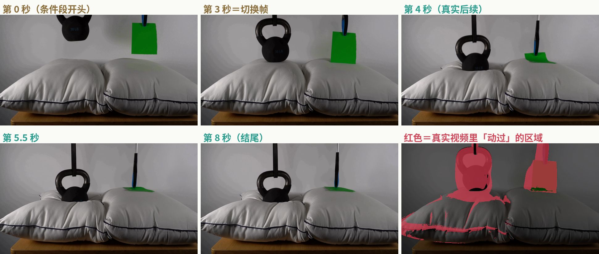
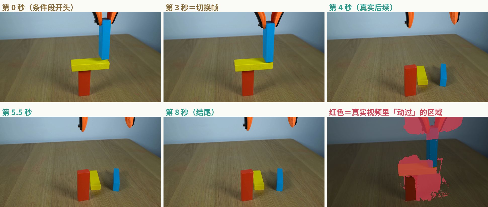
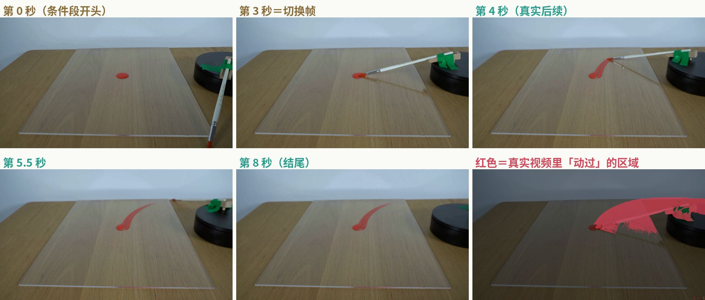
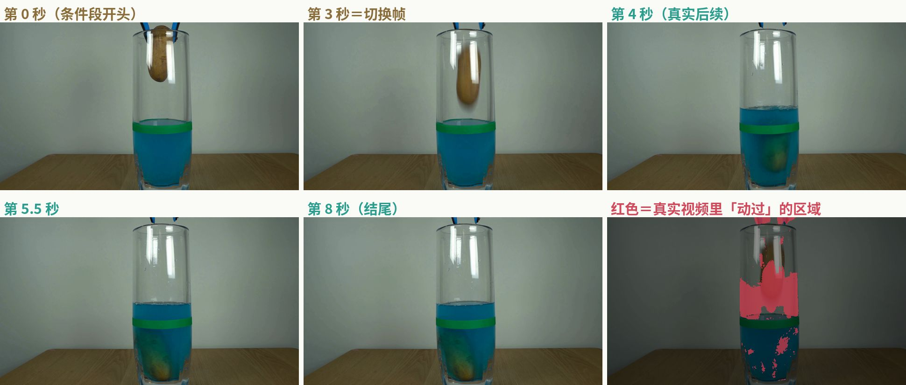
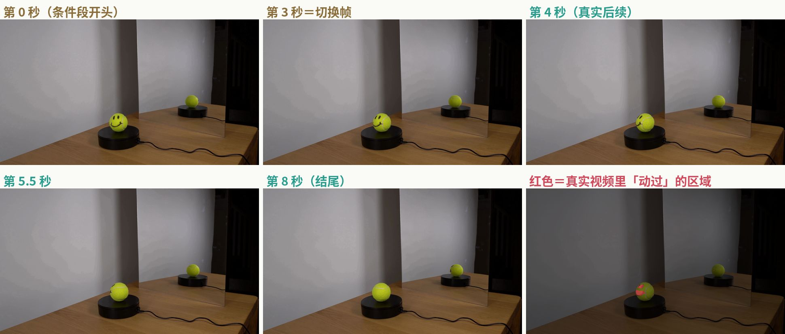
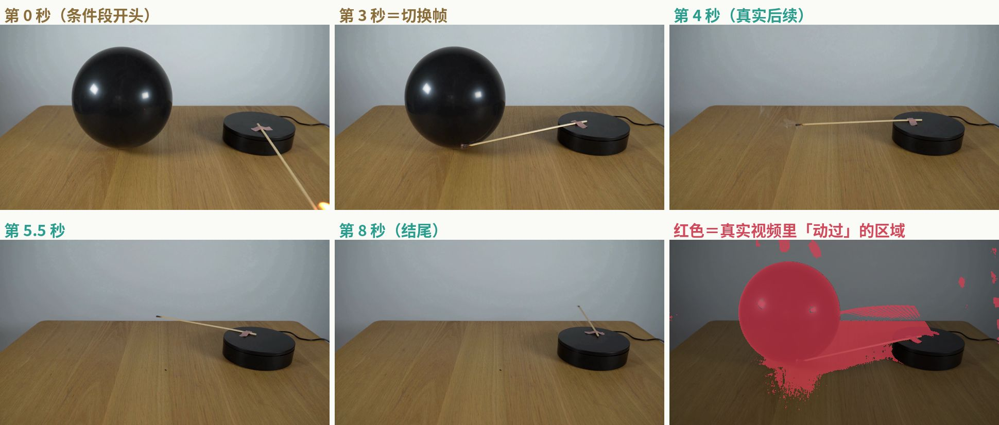
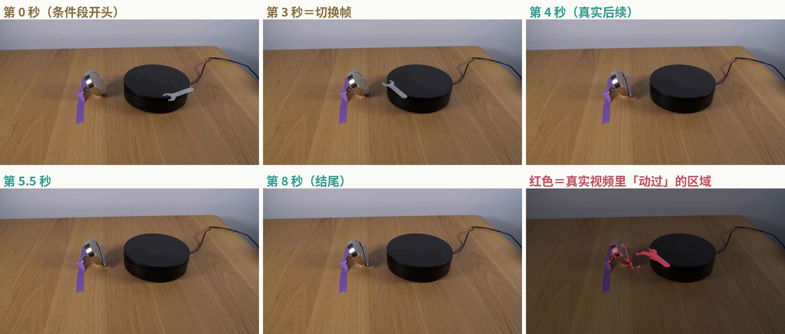
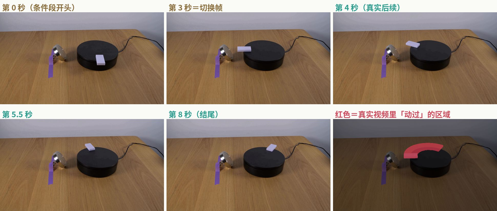

# Physics-IQ 打榜调研（2026-10-09）

> 查证时间：2026-10-09 晚上（美东）。榜单数据直接取自 Physics-IQ Verified 官网（physics-iq-verified.anates.ai）的页面数据和 GitHub 官方 README，Odyssey 的成绩说明取自它提交成绩的 GitHub PR #90。

## 先说结论

1. **Physics-IQ 是 Google DeepMind 做的「视频模型懂不懂物理」评测**：拍了 66 个真实的桌面物理实验，给模型看开头，让它接着生成 5 秒，再和真实录像对比。**Physics-IQ Verified** 是 2026 年 6 月由 Anates Labs（德国慕尼黑的一家公司）牵头、DeepMind 原作者参与做的修订版，修了提示词、清了真值里的干扰、改了打分方式，现在是官方推荐版本。
2. **榜单就两条赛道**：**视频续写（V2V）**，给模型前 3 秒视频；**图片续写（I2V）**，只给模型 1 帧。每条赛道还能按「单次生成」和「挑最好的一个（BoN）」筛。
3. **Odyssey 的 66.1 是真的，在 V2V 赛道确实排第一**，但有三个前提：① 每道题生成 8 个候选再挑 1 个（best-of-8）；② 用大模型改写了提示词；③ 只跑了 1 轮，没有标准差，按官方规则「宣称 SOTA 需要 4 轮的标准差」，这一条它没满足。不挑、只生成一次的话，Odyssey-3 Pro 是 **63.37 ± 0.63**，在 V2V 单次生成里也是第一（FLUX 3 [large] 是 61.11）。
4. **之前说的「默认榜 FLUX 3 第一 64.36、Odyssey-3 Pro 第二 61.78」要更正**：官网默认打开的是**图片续写（I2V）**赛道，不是视频续写。64.36 和 61.78 是 I2V 赛道里一个子指标（Spatial IoU）的分。I2V 默认视图里确实是 FLUX 3 第一（51.11）、Odyssey-3 Pro 第二（49.99），但这和 Odyssey 说的 V2V 66.1 不是同一个榜。
5. **怎么上榜**：数据和评测代码都公开，自己生成视频、自己跑官方代码，然后在 GitHub 提 Issue/PR 联系主办方，拿到上传凭证后把视频交上去。**不用交模型权重，不用开 API，没看到收费**。按提交条款，主办方会用你交的视频自己重新算分。
6. **对我们**：只要模型能「给开头、续写 5 秒、镜头不动」，就能参加。白模世界**不能参赛**，但可以当训练数据，尤其补固体力学（碰撞、倒塌、堆叠），这一类占全部题的 58%。最大的风险是**测试视频全是真实录像**，打分会比像素和画面变化，白模画面和真实画面差得远，有落差。

---

## Odyssey 的 66.1 到底算不算第一

**算第一，但要加限定词：V2V 赛道、best-of-8、自定义提示词、单轮。**

| 问题 | 查到的事实 | 来源 |
| --- | --- | --- |
| 66.1 是哪个榜？ | Physics-IQ **Verified**，**视频续写（V2V）**赛道，Verified 分 | 官网数据、README、PR #90 |
| 怎么跑的？ | 每道题用 8 个随机种子生成 8 个候选，再用两个**不看真值**的打分挑一个：V-JEPA 2 的「意外程度」（WMReward）和 8 个候选之间的相似度共识（MBR），两个排名相加最小的那个提交 | PR #90 |
| 提示词？ | 在官方基础提示词后面，加了一段用外部大模型（Fable 5.1）按每个视角改写的「结果描述」。PR 说改写时只看了条件视频或首帧，没看真实后续 | PR #90 |
| 跑了几轮？ | **1 轮**，没有标准差。4 轮取平均的只有不挑的版本：63.37 ± 0.63 | PR #90 |
| 符合规则吗？ | 官方规则：上榜跑 1 轮就行；**要宣称 SOTA 必须报 4 轮的标准差**。66.1 没有标准差 | README Rules 第 1 条 |
| 谁算的分？ | Odyssey 自己用官方代码（commit 4ddba5a1）在 16 fps 下跑的。提交条款写的是主办方会自己重算；但 PR 里 Pro 版的 4 个上传编号写着「待发放」，我查不到主办方重算的结果 | PR #90、提交条款第 8 条 |
| 主办方认吗？ | PR 2026-10-08 被合并，README 给它标了 🥇 v2v。DeepMind 的 Robert Geirhos 留言「congrats on the results」 | PR #90 |
| 模型公开吗？ | 不公开（私有），所以 README 里的「reported here」链接指向这个 PR | PR #90 |

**同一赛道里谁在它后面**（V2V，Verified 分，官网「Leaderboard」列表）：

| 排名 | 模型 | 分数 | 怎么生成 |
| --- | --- | --- | --- |
| 1 | Odyssey-3 Pro（Odyssey） | **66.10**（单轮，无标准差） | best-of-8，按排名相加挑选 |
| 2 | Odyssey-3（Odyssey） | 64.43（单轮，无标准差） | best-of-8，按排名相加挑选 |
| 3 | FLUX 3 [large]（Black Forest Labs） | 64.35 ± 0.22 | best-of-8，用 WMReward 加共识挑选 |
| 4 | Odyssey-3 Pro | 63.37 ± 0.63 | 单次生成，大模型改写提示词 |
| 5 | Odyssey-3 | 61.56 ± 1.20 | 单次生成，大模型改写提示词 |
| 6 | FLUX 3 [large] | 61.11 ± 0.55 | 单次生成，自定义改写提示词（README 写的是用 Claude Opus 5.5 写的） |
| 7 | Odyssey-3 | 51.76 ± 0.69 | 单次生成，官方基础提示词，不改写 |
| 8 | Cosmos3 Super（NVIDIA，开源） | 50.8 ± 2.2 | 单次生成 |
| 9 | Cosmos3 Nano（NVIDIA，开源） | 43.0 ± 2.0 | 单次生成 |

切到官网的「All」列表，还会多出微软亚洲研究院的两条（还没发布的模型）：Physical Registry + PRS **52.61**（BoN×4），Physical Registry **50.17 ± 0.72**。

**要注意的三点：**
- **差距很小**：66.10 比 FLUX 3 的 64.35 高 1.75 分，但 FLUX 3 那条有 4 轮标准差（± 0.22），Odyssey 这条没有，没法判断这 1.75 分有多稳。
- **提示词影响巨大**：同一个 Odyssey-3，用官方基础提示词是 51.76，换成大模型改写的是 61.56，**差了将近 10 分**。也就是说，榜上前几名之间的差距，有相当一部分来自提示词工程，不全是模型本身。
- **成本差很多**（按 PR 和官网的报价）：Odyssey-3 Pro 的 V2V best-of-8，生成成本约 **$2.316/条**（按每 GPU 小时 $1 算，不含挑选时的算力）；FLUX 3 [large] 的 V2V best-of-8 按 API 价算约 **$16.4/条**。

---

## 全部榜单一览

> 数据来源：Physics-IQ Verified 官网页面里的榜单数据（2026-10-09 抓取，共 41 个模型条目、16 家机构），以及 GitHub README 里的 Original 旧榜。

### 一、Verified 榜（推荐，现在大家报的都是这个）

官网有 4 个开关：**赛道**（图片续写 / 视频续写）× **分数显示**（Verified 原始分 / 比赛道平均高多少）× **采样**（全部 / 单次生成 / BoN）× **列表**（Leaderboard / All）。默认打开是：**图片续写 + 比平均高多少 + 单次生成 + Leaderboard**。

| 榜 | 测什么 | 给模型什么 | 题量 | 现在多少条 | 当前第一 |
| --- | --- | --- | --- | --- | --- |
| **V2V 视频续写 · 全部采样** | 看完一段真实实验的前 3 秒，接着生成 5 秒，和真实后续比 | 3 秒条件视频，加文字描述（可选） | 198 段视频（66 个实验 × 3 个机位） | 9 条（All 列表 11 条） | Odyssey-3 Pro 66.10（best-of-8） |
| V2V · 只看单次生成 | 同上，排除「生成多个挑最好」的条目 | 同上 | 198 | 6 条 | Odyssey-3 Pro 63.37 ± 0.63 |
| V2V · 只看 BoN | 只比「生成多个挑最好」的条目 | 同上 | 198 | 3 条 | Odyssey-3 Pro 66.10 |
| **I2V 图片续写 · 全部采样**（官网默认赛道） | 只看 1 帧（切换帧），接着生成 5 秒 | 1 张图，加文字描述 | 198 | 27 条（All 列表 30 条） | FLUX 3 [large] 54.70 ± 0.41（best-of-8），Odyssey-3 Pro 54.69 只差 0.01 |
| I2V · 只看单次生成（官网默认） | 同上 | 同上 | 198 | 24 条 | FLUX 3 [large] 51.11 ± 0.44 |
| I2V · 只看 BoN | 同上 | 同上 | 198 | 3 条 | FLUX 3 [large] 54.70 |
| 「Net improvement」视图 | 不是新榜，是把分数换算成「比这条赛道所有条目的平均分高多少个百分点」 | — | — | — | I2V 默认视图：FLUX 3 +12.27，Odyssey-3 Pro +11.15 |
| 子指标榜 4 个 | 每个子指标单独排前 5：Spatial IoU、Spatiotemporal IoU、Weighted spatial IoU、MSE | — | — | — | 见下面的子指标表 |
| 成本前沿图 | 横轴是每条视频的成本（按 24 fps 和 1280 宽度折算），纵轴是分数 | — | — | — | — |

**Leaderboard 和 All 的区别**：All 多收录「论文或公告里报过、但模型还没公开」的条目，比如微软亚洲研究院的 Physical Registry、Awomo 的 StrucPhysVideo-TI2V。

**子指标前 3**（V2V 全部采样，按官网数据排；官网每个子指标列前 5）：

| 子指标 | 看什么 | 第一 | 第二 | 第三 |
| --- | --- | --- | --- | --- |
| Spatial IoU | 「哪里动了」对不对 | Odyssey-3 Pro BoN 73.19 | Odyssey-3 Pro 单次 70.72 | FLUX 3 BoN 70.60 |
| Spatiotemporal IoU | 「哪里、什么时候动」对不对 | Odyssey-3 BoN 70.44 | Odyssey-3 Pro BoN 70.33 | FLUX 3 BoN 66.12 |
| Weighted spatial IoU | 「哪里动、动了多少」对不对 | Odyssey-3 Pro BoN 65.07 | FLUX 3 BoN 63.30 | Odyssey-3 Pro 单次 63.19 |
| MSE（换算成越高越好） | 像素层面像不像 | FLUX 3 BoN 57.39 | Odyssey-3 Pro BoN 55.81 | Odyssey-3 Pro 单次 55.40 |

**I2V 赛道前 10**（Leaderboard 列表，全部采样）：

| 排名 | 模型 | 分数 | 生成方式 |
| --- | --- | --- | --- |
| 1 | FLUX 3 [large] | 54.70 ± 0.41 | best-of-8 |
| 2 | Odyssey-3 Pro | 54.69（单轮） | best-of-8 |
| 3 | Odyssey-3 | 52.83（单轮） | best-of-8 |
| 4 | FLUX 3 [large] | 51.11 ± 0.44 | 单次 |
| 5 | Odyssey-3 Pro | 49.99 ± 0.42 | 单次 |
| 6 | Odyssey-3 | 48.83 ± 0.78 | 单次 |
| 7 | Physis-Lang (Cosmos3 Super)（开源） | 48.23 ± 1.43 | 单次 |
| 8 | Physis-Lang (Cosmos3 Nano)（开源） | 43.29 ± 1.52 | 单次 |
| 9 | Cosmos3 Super（NVIDIA，开源） | 42.68 ± 0.76 | 单次 |
| 10 | Seedance 2.5（字节） | 42.43 ± 0.76 | 单次 |

熟悉的大厂模型在 I2V 单次生成里的位置：MiniMax H3 39.79、Gemini Omni 1.1 Flash 35.34、Grok Imagine Video 34.8、Hunyuan Video 1.5 33.4、Wan 2.2 14B 32.2、Veo 3.1 Lite 31.83、Veo 3.1 Fast 29.96、Sora 2 26.5。

### 二、Original 旧榜（2025 年原版，还在 README 里，但官方已不推荐）

| 榜 | 题量 | 第一 | 说明 |
| --- | --- | --- | --- |
| Original · V2V | 198 | Magi-1 + GeoPhys（BoN）64.5% | 旧打分方式，分数**不能**和 Verified 比 |
| Original · I2V | 198 | Cosmos3-Super + WMReward（BoN）48.9% | 同上 |

原论文（2025 年）测的时候，最好的 VideoPoet（多帧）只有 29.5%，Sora 只有 10.0%。

---

## 题目示例（官方原题）

> 全部是官方数据集里的真题：中间机位、第 1 遍录像（考试用的就是这一遍）。视频和切换帧来自原版公开数据桶，两版用的是同一批录像。「Verified 提示词」取自官方基础提示词文件 `descriptions_base.csv`，每条前面还固定拼了三句：镜头固定不动、这是真实的科学演示、画面里只有描述的东西。中文是我翻译的。每个类别至少 1 道，磁学放了一对对照题。

### 例 1　固体力学 · 鸭子挡在多米诺骨牌中间

题号 0056 · Solid Mechanics · 文件 `0056_perspective-center_take-1_trimmed-duck-and-dominos.mp4`

- **真实视频里发生了什么**：一根绑在黑色转台上的木棍顺时针转过来，推倒第一块骨牌。右边那一段骨牌依次倒下，倒到黄色橡皮鸭就停住了，鸭子左边那一段骨牌一直没动。
- **模型收到什么**：V2V 收到前 3 秒视频（上图前两格之间这一段）；I2V 只收到「第 3 秒＝切换帧」这一张图。两种都可以再收到下面这段文字。
- **Verified 提示词**：A yellow rubber duck has been positioned in the middle of a line of black and white dominoes on a wooden table. The wooden stick attached to the black platform rotates clockwise and knocks the first domino block.
  - 中文：黄色橡皮鸭摆在一排黑白多米诺骨牌的中间，放在木桌上。绑在黑色转台上的木棍顺时针转动，碰倒第一块骨牌。
- **原版提示词**：A yellow rubber duck is positioned in the middle of a line of black and white dominoes on a wooden table. A stick attached to a black rotating platform rotates clockwise and knocks the first domino block. Static shot with no camera movement.
- **考的是什么**：模型容易「顺着惯性」让整排骨牌都倒，或者让鸭子也被推走。真实结果是链条在鸭子处断开，所以「哪里动、哪里不动」最关键。
- **怎么算分**：把模型生成的 5 秒和真实的 5 秒各算出运动掩码。右下角红色就是真实视频里「动过」的区域，模型动的位置、时间、多少都要和它对上；再算像素误差。最后每项除以「第 2 遍录像」能达到的水平。
- 8 秒视频（前 3 秒已给，后 5 秒是答案）：`img/0056_clip.mp4`

### 例 2　固体力学 · 壶铃和纸片同时落到枕头上

题号 0194 · Solid Mechanics · 文件 `0194_perspective-center_take-1_trimmed-weight-on-pillow.mp4`

- **真实视频里发生了什么**：左边一个 30 磅（约 13.6 公斤）的壶铃、右边一张绿色纸片，被同时放到下面的两个枕头上。壶铃把左边枕头压出一个深坑，周围枕面跟着鼓起来；纸片落在右边枕头上，枕头几乎不变形。
- **模型收到什么**：V2V 收到前 3 秒视频（上图前两格之间这一段）；I2V 只收到「第 3 秒＝切换帧」这一张图。两种都可以再收到下面这段文字。
- **Verified 提示词**：The 30-lb kettlebell and the green piece of paper are each placed onto the pillow below them simultaneously.
  - 中文：30 磅壶铃和绿色纸片同时分别放到下面的枕头上。
- **原版提示词**：A 30lb kettlebell and a green piece of paper are lowered onto two pillows. Static shot with no camera movement.
- **考的是什么**：同样是「放到枕头上」，重量不同，形变完全不同。模型要从画面判断出壶铃很重、纸很轻。
- **怎么算分**：把模型生成的 5 秒和真实的 5 秒各算出运动掩码。右下角红色就是真实视频里「动过」的区域，模型动的位置、时间、多少都要和它对上；再算像素误差。最后每项除以「第 2 遍录像」能达到的水平。
- 8 秒视频（前 3 秒已给，后 5 秒是答案）：`img/0194_clip.mp4`

### 例 3　固体力学 · 在不稳的积木上再加一块

题号 0182 · Solid Mechanics · 文件 `0182_perspective-center_take-1_trimmed-unstable-block-stack.mp4`

- **真实视频里发生了什么**：红色积木上横放着一块黄色积木，摆成 L 形，本来就勉强平衡。夹子把一块蓝色积木放到黄色积木上方后松开，整个积木堆失去平衡，黄色和蓝色积木倒下来，最后三块积木散落在桌上。
- **模型收到什么**：V2V 收到前 3 秒视频（上图前两格之间这一段）；I2V 只收到「第 3 秒＝切换帧」这一张图。两种都可以再收到下面这段文字。
- **Verified 提示词**：The yellow block is balanced on the red block, forming an L shape. The blue wooden block is placed by the orange-black grabber tool atop the yellow block.
  - 中文：黄色积木平衡在红色积木上，组成 L 形。橙黑色夹子把蓝色木块放到黄色积木上面。
- **原版提示词**：A grabber tool carefully placing a blue wooden block on top of a yellow block which is balanced on a red block forming an L shape. Static shot with no camera movement.
- **考的是什么**：考重心和稳定性：加上这块之后到底会不会塌、往哪边塌。
- **怎么算分**：把模型生成的 5 秒和真实的 5 秒各算出运动掩码。右下角红色就是真实视频里「动过」的区域，模型动的位置、时间、多少都要和它对上；再算像素误差。最后每项除以「第 2 遍录像」能达到的水平。
- 8 秒视频（前 3 秒已给，后 5 秒是答案）：`img/0182_clip.mp4`

### 例 4　流体力学 · 画笔扫过一团红颜料

题号 0131 · Fluid Dynamics · 文件 `0131_perspective-center_take-1_trimmed-paint-on-glass.mp4`

- **真实视频里发生了什么**：透明亚克力板上有一小团红颜料。绑在转台上的画笔顺时针转过来，从颜料中间划过去，在板上拖出一道弯弯的红色笔迹，然后画笔转出画面。
- **模型收到什么**：V2V 收到前 3 秒视频（上图前两格之间这一段）；I2V 只收到「第 3 秒＝切换帧」这一张图。两种都可以再收到下面这段文字。
- **Verified 提示词**：On top of the acrylic sheet was placed a small dollop of red paint. The paintbrush is attached to the black platform sitting next to the clear acrylic sheet with red paint on it on a wooden table. The paintbrush rotates clockwise on the black platform, passes through the dollop of red paint on the clear acrylic sheet, and moves past the dollop of red paint.
  - 中文：亚克力板上放了一小团红颜料。画笔绑在旁边的黑色转台上，顺时针转动，穿过红颜料并继续向前。
- **原版提示词**：A clear acrylic sheet placed on a wooden table with a small dollop of red paint. A rotating paintbrush attached to a rotating platform rotates clockwise and goes through the paint. Static shot with no camera movement.
- **考的是什么**：考颜料这种黏稠液体被拖开的样子：笔迹的方向、长度、形状，都要和真实的一致。原论文提到，当年得分最高的 VideoPoet 在这道题上表现很好。
- **怎么算分**：把模型生成的 5 秒和真实的 5 秒各算出运动掩码。右下角红色就是真实视频里「动过」的区域，模型动的位置、时间、多少都要和它对上；再算像素误差。最后每项除以「第 2 遍录像」能达到的水平。
- 8 秒视频（前 3 秒已给，后 5 秒是答案）：`img/0131_clip.mp4`

### 例 5　流体力学 · 土豆掉进一杯蓝色的水

题号 0143 · Fluid Dynamics · 文件 `0143_perspective-center_take-1_trimmed-potato-in-water.mp4`

- **真实视频里发生了什么**：夹子在杯口松开土豆，土豆掉进装了蓝色液体的高玻璃杯，沉到杯底。杯子上贴了一圈绿色胶带标出原来的水位，土豆进去后，液面升到胶带上方。
- **模型收到什么**：V2V 收到前 3 秒视频（上图前两格之间这一段）；I2V 只收到「第 3 秒＝切换帧」这一张图。两种都可以再收到下面这段文字。
- **Verified 提示词**：The blue-black grabber tool was holding the potato at the inner rim of the glass containing the blue liquid and the green water level marking. The blue-black grabber releases the potato into the glass containing blue liquid with a green band marking the water level.
  - 中文：蓝黑色夹子夹着土豆停在玻璃杯内沿。杯里是蓝色液体，绿色带子标出水位。夹子松开，土豆掉进杯里。
- **原版提示词**：A potato is held by a grabber tool and dropped into a tall glass containing blue liquid with a band of green tape marking a level on the glass. Static shot with no camera movement.
- **考的是什么**：考排水和液面变化：东西放进去，水面要升高，土豆要沉下去而不是浮着。
- **怎么算分**：把模型生成的 5 秒和真实的 5 秒各算出运动掩码。右下角红色就是真实视频里「动过」的区域，模型动的位置、时间、多少都要和它对上；再算像素误差。最后每项除以「第 2 遍录像」能达到的水平。
- 8 秒视频（前 3 秒已给，后 5 秒是答案）：`img/0143_clip.mp4`

### 例 6　光学 · 镜子前旋转的笑脸网球

题号 0119 · Optics · 文件 `0119_perspective-center_take-1_trimmed-mirror-ball-rotate.mp4`

- **真实视频里发生了什么**：一个画了笑脸的网球放在转台上，在一面镜子前面慢慢顺时针转。一开始镜子里照到的是网球没画笑脸的那一面；网球转过去以后，镜子里的倒影跟着变。整段视频里真正在动的只有网球，动的面积不到画面的 1%。
- **模型收到什么**：V2V 收到前 3 秒视频（上图前两格之间这一段）；I2V 只收到「第 3 秒＝切换帧」这一张图。两种都可以再收到下面这段文字。
- **Verified 提示词**：The mirror points towards the tennis ball and initially reflects the side of the tennis ball without a smiley face. The tennis ball with a smiley face sits on the black platform. The tennis ball with a smiley face rotates slowly clockwise on the black platform in front of the mirror.
  - 中文：镜子对着网球，一开始照出的是网球没有笑脸的那一面。画着笑脸的网球放在黑色转台上，在镜子前慢慢顺时针转动。
- **原版提示词**：A tennis ball with a smiley face drawn on it is slowly rotating on a black rotating platform that rotates clockwise in front of a mirror and reflecting the side of the ball that has no smiley face. Static shot with no camera movement.
- **考的是什么**：考反射：镜子里的倒影必须和网球本身同步变化。这类「动得很少」的题，模型乱动一点就会被扣分。
- **怎么算分**：把模型生成的 5 秒和真实的 5 秒各算出运动掩码。右下角红色就是真实视频里「动过」的区域，模型动的位置、时间、多少都要和它对上；再算像素误差。最后每项除以「第 2 遍录像」能达到的水平。
- 8 秒视频（前 3 秒已给，后 5 秒是答案）：`img/0119_clip.mp4`

### 例 7　热力学 · 火柴碰到气球

题号 0113 · Thermodynamics · 文件 `0113_perspective-center_take-1_trimmed-match-blows-balloon.mp4`

- **真实视频里发生了什么**：一根点着的火柴绑在转台上，转过去碰到旁边的黑色气球，气球一下子爆掉，从画面里消失，只剩转台和火柴继续转。
- **模型收到什么**：V2V 收到前 3 秒视频（上图前两格之间这一段）；I2V 只收到「第 3 秒＝切换帧」这一张图。两种都可以再收到下面这段文字。
- **Verified 提示词**：The black balloon was placed on a wooden table next to the black platform. The lit match is attached to the black platform. The lit match rotates clockwise on the black platform and touches the black balloon.
  - 中文：黑色气球放在木桌上，旁边是黑色转台。点着的火柴绑在转台上，顺时针转动，碰到黑色气球。
- **原版提示词**：A black balloon is sitting on a wooden table next to a small rotating platform with a lit matchstick taped to it. The match rotates clockwise and touches the balloon. Static shot with no camera movement.
- **考的是什么**：考「受热会破」这个因果：模型要让气球爆，而不是被火柴推开或者没事。
- **怎么算分**：把模型生成的 5 秒和真实的 5 秒各算出运动掩码。右下角红色就是真实视频里「动过」的区域，模型动的位置、时间、多少都要和它对上；再算像素误差。最后每项除以「第 2 遍录像」能达到的水平。
- 8 秒视频（前 3 秒已给，后 5 秒是答案）：`img/0113_clip.mp4`

### 例 8　磁学 · 扳手转到磁铁旁边

题号 0101 · Magnetism · 文件 `0101_perspective-center_take-1_trimmed-magnet-wrench.mp4`

- **真实视频里发生了什么**：一把小金属扳手放在转台上，转台前面摆着一块强力磁铁。扳手转到磁铁附近时，被磁铁吸离转台，贴在磁铁上不动了，之后转台空转。
- **模型收到什么**：V2V 收到前 3 秒视频（上图前两格之间这一段）；I2V 只收到「第 3 秒＝切换帧」这一张图。两种都可以再收到下面这段文字。
- **Verified 提示词**：The small metal wrench was placed on the black platform. The powerful magnet sits on the table facing the black platform. The small metal wrench rotates clockwise on the black platform near the powerful magnet.
  - 中文：小金属扳手放在黑色转台上，强力磁铁放在桌上、正对转台。扳手在转台上顺时针转动，经过磁铁附近。
- **原版提示词**：A powerful magnet is placed on the table facing a black rotating platform that rotates clockwise. A small metal wrench is placed on the platform and is rotating towards the magnet. Static shot with no camera movement.
- **考的是什么**：考磁力：金属会被吸过去。要和下面那道「塑料骨牌」题对着看。
- **怎么算分**：把模型生成的 5 秒和真实的 5 秒各算出运动掩码。右下角红色就是真实视频里「动过」的区域，模型动的位置、时间、多少都要和它对上；再算像素误差。最后每项除以「第 2 遍录像」能达到的水平。
- 8 秒视频（前 3 秒已给，后 5 秒是答案）：`img/0101_clip.mp4`

### 例 9　磁学 · 塑料骨牌转到磁铁旁边（对照题）

题号 0095 · Magnetism · 文件 `0095_perspective-center_take-1_trimmed-magnet-domino.mp4`

- **真实视频里发生了什么**：场景和上一题完全一样，只是把扳手换成了白色塑料骨牌。骨牌转过磁铁旁边，没有被吸走，跟着转台继续转。
- **模型收到什么**：V2V 收到前 3 秒视频（上图前两格之间这一段）；I2V 只收到「第 3 秒＝切换帧」这一张图。两种都可以再收到下面这段文字。
- **Verified 提示词**：The small white domino was placed on the black platform. The powerful magnet sits on the table facing the black platform. The small white plastic domino rotates clockwise on the black platform near the powerful magnet.
  - 中文：白色小骨牌放在黑色转台上，强力磁铁放在桌上、正对转台。白色塑料骨牌在转台上顺时针转动，经过磁铁附近。
- **原版提示词**：A powerful magnet is placed on the table facing a black rotating platform that rotates clockwise. A small white plastic domino block is placed on the platform and is rotating towards the magnet. Static shot with no camera movement.
- **考的是什么**：这是对照：模型不能看见磁铁就让东西飞过去，要分清金属和塑料。
- **怎么算分**：把模型生成的 5 秒和真实的 5 秒各算出运动掩码。右下角红色就是真实视频里「动过」的区域，模型动的位置、时间、多少都要和它对上；再算像素误差。最后每项除以「第 2 遍录像」能达到的水平。
- 8 秒视频（前 3 秒已给，后 5 秒是答案）：`img/0095_clip.mp4`

---

## 1. Physics-IQ 是什么

| 项目 | 原版 Physics-IQ | Physics-IQ Verified |
| --- | --- | --- |
| 谁做的 | Saman Motamed（INSAIT，索菲亚大学；工作在 DeepMind 期间完成）、Laura Culp、Kevin Swersky、Priyank Jaini、Robert Geirhos（后四位都是 Google DeepMind） | Tim Rädsch、Carsten T. Lüth（Anates Labs，共同牵头），Yuki M Asano、Hilde Kuehne、Stefan Bauer，加上 DeepMind 的 Priyank Jaini、Robert Geirhos（顾问） |
| 论文 | 《Do generative video models understand physical principles?》arXiv 2501.09038，2025-01-14 首发，发表于 WACV 2026 | 《Physics-IQ Verified》arXiv 2606.18943，2026-06-17 |
| 网站 | physics-iq.github.io | physics-iq-verified.anates.ai |
| 代码 | github.com/google-deepmind/physics-IQ-benchmark（两个版本共用，默认跑 Verified） | 同左 |
| 数据 | Google Cloud 公开桶 `physics-iq-benchmark` | HuggingFace `Anates-Labs-Research/Physics-IQ-Verified`（要点申请，自动通过），CC BY 4.0 |
| 声明 | — | README 写明：Verified 是独立第三方评测，**不由 Google DeepMind 背书或验证** |

**数据集长什么样：**
- **66 个物理实验**，每个用 3 台相机（左、中、右）同时拍，每个实验拍 **2 遍**（take 1、take 2）。共 66 × 3 × 2 = **396 段**，每段 8 秒，4K（3840×2160），30 fps，**镜头完全不动**。
- **考试只用第 1 遍的 198 段**。第 2 遍不考，用来算「真实世界本身有多随机」（见下面的打分）。
- **5 个物理类别**（按官方描述文件统计）：

| 类别 | 实验数 | 考试视频数 | 例子 |
| --- | --- | --- | --- |
| 固体力学 Solid Mechanics | 38 | 114 | 多米诺骨牌、积木倒塌、壶铃压枕头、牛顿摆、杯子摔碎 |
| 流体力学 Fluid Dynamics | 15 | 45 | 倒果汁、颜料被刷开、东西掉进水里、纸巾吸水 |
| 光学 Optics | 8 | 24 | 灯照旋转物体的影子、镜子里的倒影 |
| 热力学 Thermodynamics | 3 | 9 | 蜡烛燃烧、火柴烧气球、纸燃烧冒烟 |
| 磁学 Magnetism | 2 | 6 | 磁铁吸扳手、磁铁不吸塑料骨牌 |

> 官方分类里有几个看着不太对的：「吹气球」和「火柴伸进水里」被归到流体力学，「透明盒子罩住网球」被归到固体力学。我按官方文件照抄。

**每道题怎么考：**
- 每段 8 秒的视频切成两半：**前 3 秒是条件**，**后 5 秒是标准答案**。前 3 秒的最后一帧叫**切换帧**（switch frame），是人工挑的：刚好在关键事件发生之前，比如第一块骨牌刚被碰到、还没碰到第二块。
- **V2V 模型**：给前 3 秒视频，最多 3 秒，能吃几帧给几帧。**I2V 模型**：只给切换帧这一张图。两种都可以再给一段文字描述。
- 模型生成**正好 5 秒**（±0.001 秒）。V2V 不能把条件那 3 秒算进去。帧率可以选 8、16、24、30 fps，评测时用对应帧率的真值。

**Verified 改了什么**（论文和 HuggingFace 数据卡）：
1. **改提示词**：34.8% 的提示词有问题，分四种：写错事实（12 个，比如球的颜色写错）、时间写错（12 个，把已经发生的事写成待发生）、漏了关键信息（54 个，比如没说杯子是陶瓷的）、措辞含糊（9 个）。另外把提示词拆成 6 个字段，按各家模型的官方写法拼（这就是「bpp 最佳实践提示词」），并固定加上「镜头不动」「这是真实的科学演示」「画面里只有描述的东西」。
2. **清理真值里的干扰**：29.8% 的视频里有和物理现象无关的动静（比如设备在转、录制时偶然的晃动），会被算成「动作」。人工标出来后，从真值的运动掩码里去掉。
3. **改打分**：原版在整个数据集上汇总，Verified 改成**每道题单独打分再平均**，每道题、每个指标权重相等，也能追溯是哪道题拖了分。
4. 合计改动了 57.6% 的题。论文用 6 个 I2V 模型对比，新旧排名的一致程度 Kendall τ = 0.46，排名有明显变化。

## 2. 怎么打分

**核心思路**：不看「好不好看」，看「哪里动、什么时候动、动了多少、像素像不像」。因为镜头不动，只要比较相邻帧的像素变化、超过阈值的地方就算「在动」，得到一个「运动掩码」。真实视频和生成视频各算一个，再拿来比。

| 指标 | 问的是 | 怎么算 |
| --- | --- | --- |
| **Spatial IoU** | 哪里动了？ | 把 5 秒的运动掩码沿时间叠成一张图（动过就算 1），和真实的比重叠面积（交集 ÷ 并集） |
| **Spatiotemporal IoU** | 哪里、什么时候动？ | 逐帧比运动掩码，再平均。位置对、时间不对也会扣分 |
| **Weighted spatial IoU** | 哪里动、动了多少？ | 叠成图的时候按「动了多少帧」加权，能分清钟摆来回动和球滚过一次 |
| **MSE** | 像素像不像？ | 逐像素的均方误差，越低越好。物体颜色变了会被重罚 |

**总分怎么来：**
- **上限是「真实世界的随机性」**：同一个实验拍的第 2 遍，和第 1 遍也不会完全一样（摩擦、力度有细微差别）。拿第 2 遍当成一个「完美模型」的输出去打分，这个分数就是 100%。原论文里这个「物理方差」在四个指标上分别是 Spatial IoU 0.678、Spatiotemporal IoU 0.535、Weighted spatial IoU 0.577、MSE 0.002。
- **原版总分**：在整个数据集上把三个 IoU 加起来、减去 MSE，再除以物理方差归一化。
- **Verified 总分**：每道题单独算。三个 IoU 各自除以这道题的物理方差，MSE 用「物理方差 ÷ 模型的 MSE」，四项各自截断到 0 到 1 之间，取平均就是这道题的分。198 道题再平均，就是总分。**所以 100 分的意思是：每道题都和「再拍一遍的真实视频」一样准。**
- **官方建议跑 4 轮**（4 套独立生成的 198 段视频），报「平均值 ± 标准差」。1 轮也能上榜，但要宣称 SOTA 必须有 4 轮的标准差。
- 原版论文另外还用 Gemini 1.5 Pro 做过一个「真假二选一」测试，看生成视频像不像真的，结论是**画面逼真和懂物理没关系**（Sora 最能骗过 AI，但物理分很低）。这个测试不计入总分。

## 3. 怎么上榜（官方流程）

1. **下数据**：HuggingFace 上的 Verified 数据集（点申请，自动通过）。
2. **装环境**：`uv sync`，需要 ffmpeg。
3. **选提示词**：用官方基础提示词 `descriptions_base.csv`，或者按自家模型的写法加一个模板类，生成自己的描述文件。
4. **生成视频**：每轮 198 段，每段正好 5 秒，文件名带编号前缀（`0001_` 到 `0198_`）。建议跑 4 轮。
5. **跑官方评测**：`physiq/run_physics_iq.py`，读每轮结果里的 verified 分，再用 `aggregate_runs_from_csvs.py` 算平均和标准差。
6. **联系主办方**：在 GitHub 提 Issue 或 PR，告诉他们机构名和一个描述性 ID，他们会发一个 run_id 和一组只对这次上传有效、会过期的 AWS 临时凭证。
7. **准备提交包**：`submission.yaml`（模型信息、生成成本、自报分数、同意条款）+ 实际用的 `descriptions.csv` + 每轮 198 个 MP4。先用 `submit_verified.py --validate-only` 本地检查。
8. **上传**：用凭证传到他们的 S3；不想用 S3，也可以打包后用网盘之类的方式给他们。
9. **上 README 榜**：提 PR 往 README 表格加一行，**必须附技术报告、可复现的代码仓库或其他文档**。

**规则要点：**
- **不用交权重，不用开 API**。模型可以是私有的（Odyssey 就是）。
- **测试数据绝对不能用来提分**：不能用来做 BoN 挑选，也不能给提示词改写器看。README 特别提醒：用前沿大模型改写提示词时要断网，防止它自己去下载测试数据。
- **Original 和 Verified 共用同一批实验**，不能用一个版本的信号去提另一个版本的分。
- **提交的视频保密**：只公开模型名、机构、分数、日期。原始视频和提示词存在欧盟区的私有存储里，主办方只用来算分和做内部研究，不公开、不拿去训练自己的模型；需要的话可以签 NDA。
- **主办方自己重算分数**，不采用你自报的分数。提交后**一般不能撤回**。发现污染、刷分会被标记或取消资格。
- **视频里不能有个人数据**（人脸、人声、可识别的人）。
- **费用**：README 和条款里都没有提到收费。成本主要是自己的算力：1 轮 198 段，4 轮 792 段；best-of-8 每轮要生成 1,584 段。
- **时间**：参考 Odyssey，PR 是 10-05 开的，10-08 合并，中间还补交过一次结果。

## 4. 我们能不能打？白模世界有什么用

**能不能参赛：看模型能不能做这三件事。**
1. **给开头、往后续写**：给 1 张图（I2V）或者 3 秒视频（V2V），输出正好 5 秒。
2. **镜头不动**：所有考试视频都是固定机位。打分靠像素变化找「哪里在动」，镜头一动整个画面都算在动，分数会很难看。交互式世界模型如果默认带视角移动，要能关掉，或者给「不操作」的指令。
3. **不需要动作输入**：考试只有画面加文字，没有按键或相机轨迹。按键或相机控制的模型，要能在「没有动作」的情况下往下生成。

**选哪条赛道：**
- 能吃多帧的，优先打 **V2V**：信息更多，分数普遍高（V2V 前 6 名都在 61 分以上，I2V 第一才 54.7），而且大家看 Odyssey 主要看这条。
- 只能吃单帧的，打 **I2V**，竞争者多（27 条），开源模型的分数从 27.7（Wan 2.2 5B）到 48.23（Physis-Lang Cosmos3 Super）。

**白模世界：不能参赛，可以当训练数据。**

| 能帮上的 | 为什么 |
| --- | --- |
| 固体力学 | 占 38/66 个实验、114/198 道题，是大头。碰撞、骨牌连锁、堆叠倒塌、重物下压、滚动，这些游戏引擎的刚体物理能模拟，还能给出**精确的物理真值**（位置、速度、接触时间） |
| 「哪里动、哪里不动」 | 白模能精确控制只有一部分物体动（比如鸭子挡住骨牌），正好对应 IoU 类指标 |
| 固定机位数据 | 引擎里固定相机很容易，可以批量造「镜头不动 + 物理事件」的片段 |
| 对照题 | 同一场景只换材质或重量（金属和塑料、壶铃和纸），教模型分清条件 |

| 帮不上或有风险的 | 为什么 |
| --- | --- |
| 真实画面落差（sim-to-real） | 测试全是真实 4K 录像，MSE 直接比像素。白模画面偏素，模型学到的「物理」能不能迁移到真实画面没有保证。需要真实感渲染、材质和光照随机化，或者和真实视频混着训 |
| 流体、热、光 | 颜料、果汁混合、燃烧、爆气球、镜面反射，一般游戏引擎模拟得不好，这几类加起来占 28 个实验 |
| 污染红线 | 测试数据是公开的（CC BY 4.0），**不能拿来训练或调参**。用白模把这 66 个实验**一比一复刻**出来训练，规则里没有明文禁止，但很容易被质疑是针对测试集刷分。建议做通用的物理课程，不照着题目搭 |
| 提示词占比大 | 同一个 Odyssey-3，换提示词能差将近 10 分。就算模型练好了，不做提示词工程也会吃亏 |

## 5. 打榜路线（建议）

1. **先确认能力（1 天）**：模型能不能「给 1 帧或 3 秒、续写 5 秒、镜头不动、不给动作」。不能的话，先补这个推理模式。
2. **内部摸底（几天）**：下载 Verified 数据，用官方基础提示词在 I2V 和 V2V 各跑 1 轮，再用官方代码算分。对照榜上的位置：开源的 Cosmos3 Super V2V 是 50.8，单次生成第一是 63.37。
3. **按类别和题目找短板**：Verified 能看到每道题的分，按 5 个类别统计，看是哪类拖分。我估计固体力学是最该先补、也最能靠白模补的。
4. **用白模补数据，再做提示词**：造固定机位的刚体物理片段，带物理真值，配真实感渲染。同时写一个适配自家模型的提示词模板（官方允许），这块性价比很高。
5. **正式提交**：单次生成跑满 **4 轮**，报平均值 ± 标准差，这是官方宣称 SOTA 的硬门槛。BoN 可以另报一条，但挑选时不能用真值，要把挑选方法写清楚。附技术报告，在 GitHub 提 Issue 联系主办方。

## 6. 和 WBench 比

| | **Physics-IQ Verified** | **WBench** |
| --- | --- | --- |
| 谁做的 | Anates Labs + DeepMind 原作者（原版是 DeepMind） | 美团 LongCat + 复旦 |
| 考什么 | **被动的物理预测**：看开头，猜真实世界接下来发生什么 | **交互控制**：按键、相机或文字指令下，世界能不能听话、前后一不一致 |
| 题目 | 66 个真实桌面实验，198 段，镜头不动 | 289 道题（导航 158 道），一张起始图加多轮操作，一半写实、一半风格化 |
| 有没有标准答案 | **有**，真实录像，逐像素比 | 没有唯一答案，用自动指标加大模型打分 |
| 动作输入 | 没有 | 有，这是核心 |
| 榜上有谁 | Odyssey-3、FLUX 3、Cosmos3、Seedance 2.5、Veo 3.1、Sora 2 等视频模型 | Zing-0.5、JoyAI-Echo、HY-World、Kling 3.0 等交互式世界模型和视频模型 |
| 白模的用处 | 补固体力学训练数据，但有真实画面落差 | 补导航和「转一圈回原点」的一致性，直接对口 |
| 提交 | GitHub 联系，S3 上传，主办方重算 | 网盘加邮件，人工审核 |

**哪个更适合我们**：
- 我们的模型如果是**按键或相机控制的交互式世界模型**，**WBench 更对口**，白模数据直接用得上，Navi 榜对按键模型开放。
- **Physics-IQ 是「物理可信度」的招牌**：Odyssey-3 这次发布就拿它做标题，NVIDIA 的 Cosmos3 技术报告也报了这个分。适合作为第二目标：先在内部摸底，确认模型能续写、镜头稳，再决定要不要正式打。
- 最理想的是两个都报：WBench 证明「能交互」，Physics-IQ 证明「懂物理」。

## 没能核实的地方

- **主办方是否已经重算 Odyssey-3 Pro 的分**：PR 里 Pro 的 4 个上传编号写着「待发放」。条款说主办方会自己重算，但我找不到重算后的公开结果。榜上的数字和 PR 自报的一致。
- **官网和 README 有几处数字对不上**：微软亚洲研究院 Physical Registry + PRS 的 V2V，官网写 52.61、BoN×4，README 写 51.86、BoN=8；I2V 官网 46.08，README 46.66。FLUX 3 的加入日期，官网写 10-04，README 写 10-06。Magi-1 的几条在 README 的 Verified 榜里有，但官网把它们隐藏了，原因没写。
- **示例题用的是原版公开数据**：Verified 的 HuggingFace 数据要申请才能下，我没有申请。示例里的视频和切换帧来自原版的 Google Cloud 公开桶，两版的实验和录像是同一批；Verified 改的是提示词和真值掩码。图里红色的「动过区域」用的是**原版**掩码，Verified 版清理过干扰，会更干净一些。示例里的「Verified 提示词」取自 GitHub 上 Verified 的官方基础提示词文件。
- **我们的模型是什么输入方式**（单帧、多帧、按键、相机），我不知道，所以第 4、5 节是按「能做图片或视频续写」写的。
- 原版官网 physics-iq.github.io 的榜单是动态加载的，我没抓到，原版分数用的是 README 里的表。

## 来源

- Physics-IQ Verified 官网与榜单：https://physics-iq-verified.anates.ai/
- 数据修订示例页：https://physics-iq-verified.anates.ai/dataset-fixes/
- GitHub 官方仓库与 README（含两个榜、规则、提交流程）：https://github.com/google-deepmind/physics-IQ-benchmark
- Odyssey 提交成绩的 PR #90：https://github.com/google-deepmind/physics-IQ-benchmark/pull/90
- 原版论文 arXiv 2501.09038：https://arxiv.org/abs/2501.09038
- Verified 论文 arXiv 2606.18943：https://arxiv.org/abs/2606.18943
- 原版官网：https://physics-iq.github.io/
- Verified 数据集（HuggingFace）：https://huggingface.co/datasets/Anates-Labs-Research/Physics-IQ-Verified
- 原版数据（Google Cloud 公开桶）：https://console.cloud.google.com/storage/browser/physics-iq-benchmark
- 提交条款：https://docs.google.com/document/d/1uTDIuPDtMrELTg9YqNdQwxw5q82pDJnr9xAGurNHZ2M
- 媒体对 66.1 的报道（The Next Web）：https://thenextweb.com/news/odyssey-3-world-model-robots-humanoids-cars-drones
- 我们之前的 WBench 调研：https://oricter.github.io/product-radar-reports/research/wbench/
